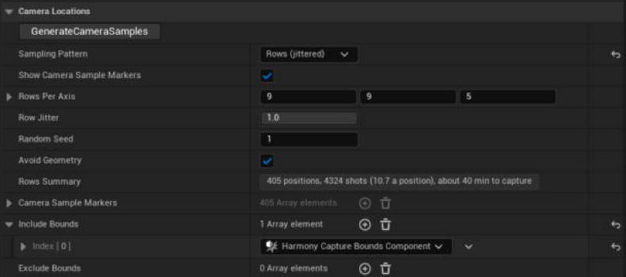
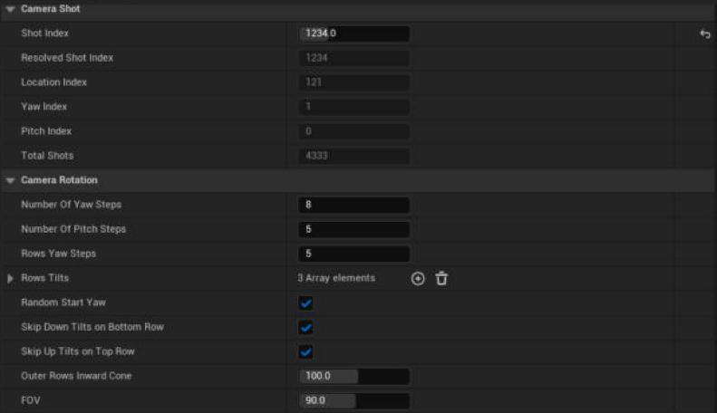
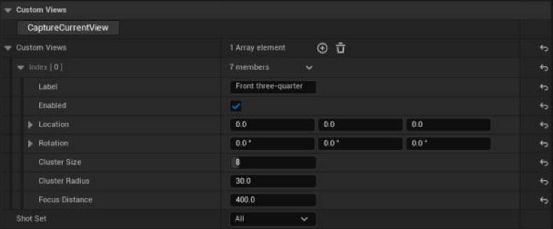
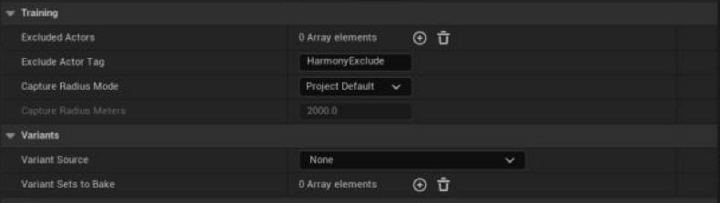
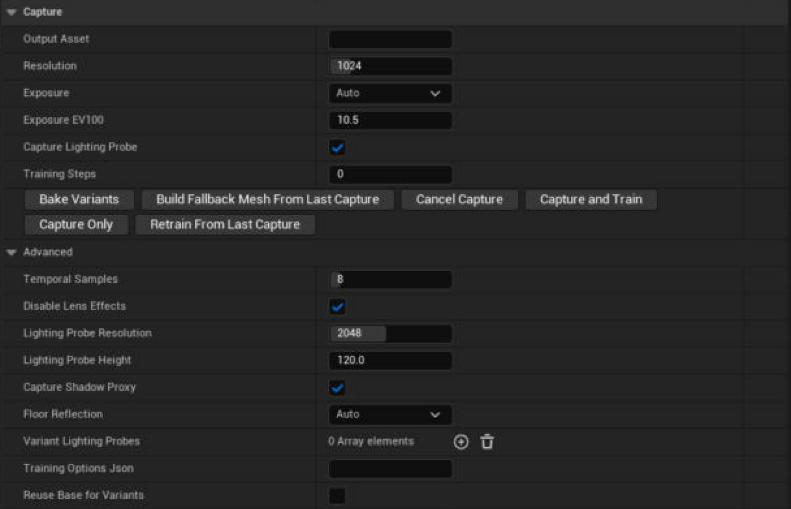

# The Capture Rig

The Harmony Capture Rig decides where the cameras go. It is a square-format camera that visits every camera position in turn, one shot per rendered frame. This page covers placing it, sizing the view area, choosing a camera pattern, and the settings that control what gets trained.

## Placing the rig

1. Open the **Place Actors** panel, search for **Harmony Capture Rig** and drag it into the level.
2. Move the rig to the spot where your product, vehicle or main subject will stand, with the rig's origin on the floor.

The rig's location matters for two reasons:

- The include and exclude boxes are positioned relative to the rig.
- The [lighting probe](06_LightingCapture.md) is captured above the rig's origin, and the shadow and floor reflection data are captured from the ground around it.

A new rig starts with the **Rows (jittered)** pattern and one include box of 16 x 16 x 2.5 m that begins 20 cm above the rig's origin. That is a sensible starting point for a showroom-sized space.

Keep one rig per level. If a level has several, exclusions, the capture radius and the lighting probe come from the first one found.

## The view area

The view area is where the cameras stand, which is also where a viewer of the finished splat can stand and see a clean image. It is not the area that gets captured: cameras see everything around them.

In the rig's **Details** panel, under **Camera Locations**:

| Setting | What it does |
|---|---|
| **Include Bounds** | A list of boxes that hold camera positions, drawn green. Each has a **Location** (relative to the rig) and a **Box Extent** (half size, in cm) under **Shape**. Boxes can be rotated. |
| **Exclude Bounds** | A list of boxes where no camera is placed, drawn red. Use them to keep cameras out of a pillar, a wall or the space a car occupies. |
| **Show Camera Sample Markers** | Shows each camera position as a small green cube. |
| **Generate Camera Samples** (button) | Rebuilds the camera positions. This also happens automatically when you edit the rig. |



### Sizing the view area

- **Cover where the camera will go at runtime**, plus a little margin. If your experience orbits a car at 4 to 7 m, the box should cover that ring. If the viewer walks a room, cover the walkable floor.
- **Set the height to the eye heights you need.** The default box spans 0.2 m to 2.7 m above the floor, which covers a crouch to a raised camera.
- **Do not make it bigger than you need.** With the Rows pattern the camera count stays the same when you resize the box, so a larger box spreads the same cameras more thinly. With Grid, a larger box adds cameras and capture time.
- **Use several include boxes** for an L-shaped space or two separate viewing areas, instead of one box that covers space nobody will stand in.

## Camera patterns

**Sampling Pattern**, under **Camera Locations**, chooses how positions fill the include boxes.

| Pattern | Use it when |
|---|---|
| **Rows (jittered)** | Almost always. It is the default and the recommended pattern. |
| **Grid** | You want a regular, predictable lattice at a fixed spacing, for example to compare with an older capture. |
| **Radial** | The subject is a single object viewed from a ring around it, such as a turntable-style orbit. |

### Rows (jittered) (recommended)

Rows places a set number of rows along each axis of the box, spread edge to edge, then moves each position randomly within its cell. The irregular spacing avoids the repeating patterns a strict grid can leave in a trained splat, and each position takes fewer, better-aimed shots.

Under **Camera Locations**:

| Setting | Default | What it does |
|---|---|---|
| **Rows Per Axis** | 9, 9, 5 | Rows along the box's X, Y and Z. 3 gives one row on each face and one in the middle. Resizing the box changes the spacing, not the count. |
| **Row Jitter** | 1.0 | How far a position may move from its row point: 0 is a regular grid, 1 is anywhere in its cell. Positions never leave the box. |
| **Random Seed** | 1 | Seed for the jitter and the starting angles. The same seed and settings always give the same cameras. Variant captures rely on this, so do not change it between a base capture and its variants. |
| **Avoid Geometry** | On | A position that would sit inside scene geometry is drawn again within its cell, and dropped if no free spot is found. |
| **Rows Summary** | (read only) | Positions, shots and an estimated capture time. |

Under **Camera Rotation**:

| Setting | Default | What it does |
|---|---|---|
| **Rows Yaw Steps** | 5 | Headings per tilt at each position, evenly spaced. 5 at a 90 degree field of view overlaps neighbouring shots by 18 degrees. |
| **Rows Tilts** | -60, 0, 60 | Camera tilts in degrees (positive looks up). These three with a 90 degree field of view cover the whole sphere. |
| **Random Start Yaw** | On | Each position starts its headings at a random angle, so frame edges do not line up from one position to the next. |
| **Skip Down Tilts on Bottom Row** | On | The lowest row looks out along the floor instead of straight into it. |
| **Skip Up Tilts on Top Row** | On | The highest row skips the upward tilts. |
| **Outer Rows Inward Cone** | 100 | Positions on the box's outer rows keep only shots heading within this many degrees of the box centre, so they look in and across the scene, not out of it. 180 keeps every shot. |

**Reading the Rows Summary.** It looks like this:

```
405 positions, 4324 shots (10.7 a position), about 40 min to capture
```

If positions were removed it adds, for example, `; 12 cells dropped (geometry or exclude boxes)`. The time estimate assumes about 0.56 seconds a shot, measured at resolution 1024 with 8 temporal samples on an RTX 3090-class GPU. Treat it as a guide.

As a reference, a showroom with one 16 x 16 x 2.5 m box and the default 9, 9, 5 rows gives roughly 4,300 shots. That has been enough for a clean result. To shorten a capture, lower **Rows Per Axis** first.

### Grid

Grid puts a position every **Grid Spacing** cm (default 100) inside each include box and skips positions inside exclude boxes. Every position takes a full sweep: one shot straight up, one straight down, and **Number Of Yaw Steps** headings for each of the remaining pitches.

Shots per position = 2 + **Number Of Yaw Steps** x (**Number Of Pitch Steps** - 2). With the defaults of 8 and 5 that is 26.

Grid grows quickly. A box with a 7 x 7 x 1 m half extent at a spacing of 200 cm gives 128 positions and 3,328 shots. Halving the spacing multiplies that by about eight.

### Radial

Radial places positions on rings that follow the ellipse inscribed in each include box. **Radial Angle Steps** (default 10) sets the positions per ring and **Radial Height Steps** (default 1) the number of rings up the box. Each position takes the same sweep as Grid.

Use it for an object you only view from around its outside. It leaves the middle of the box without cameras, so it suits a walkable space poorly.

### Field of view

**FOV** under **Camera Rotation** (default 90) applies to every pattern. The Rows defaults are tuned for 90 degrees. Leave it unless you have a reason to change it.

## Checking the shots

Before a long capture, look through the rig's camera.



Under **Camera Shot**, drag **Shot Index** to step through every pose. Pilot the rig (right-click the rig in the Outliner and choose **Pilot**) or use a camera preview to see what each shot sees. The read-only fields show the resolved shot, its location, yaw and pitch indices, and **Total Shots**.

Look for cameras inside walls or furniture, and for cameras pressed against a surface. Fix them with an exclude box or by resizing the include box.

## Custom views

Pattern cameras cover the view area evenly. A custom view adds extra training data for one viewpoint that matters, such as the hero shot of a marketing camera or a spot the pattern covers thinly.



To add one: move the level viewport to the view you want, select the rig, and under **Custom Views** press **Capture Current View**. Each entry has:

| Setting | Default | What it does |
|---|---|---|
| **Label** | | A name for your own reference. |
| **Enabled** | On | Untick to leave the view out without deleting it. |
| **Location**, **Rotation** | | The camera pose in world space. |
| **Cluster Size** | 8 | Extra cameras on a ring around the view, all aimed at the same point. A single viewpoint gives the trainer no parallax, so the ring is what makes the view useful. 0 means the view alone. |
| **Cluster Radius** | 30 cm | Radius of that ring. |
| **Focus Distance** | 400 cm | How far in front of the view the ring cameras aim. Set it to the distance of the subject. |

Each enabled custom view adds 1 + **Cluster Size** shots after the pattern shots.

**Example.** A configurator has a fixed "front three-quarter" camera 5 m from the car. Fly the viewport to that camera, press **Capture Current View**, set **Focus Distance** to 500. The capture gains 9 shots concentrated on exactly that view.

**Shot Set** chooses which shots the rig captures:

| Shot Set | Captures |
|---|---|
| **All** | The pattern shots, then every custom view. The normal choice. |
| **Samples Only** | The pattern shots only. |
| **Custom Views Only** | The custom views only. |

**Custom Views Only** is meant for refining an existing splat with a few new views, which is currently a Python-only workflow (see [Automation](08_Automation.md#refining-with-custom-views)). Do not press **Capture and Train** with it selected: you would train a splat from a handful of views. A **Custom Views Only** capture is also stored as the level's newest base capture, so switch back to **All** and capture again before using **Retrain From Last Capture**.

## Exclusions

Some things in the level should not end up in the splat. The usual case is the object you will add back as a real mesh, such as the car in a configurator.



Under **Training**:

| Setting | Default | What it does |
|---|---|---|
| **Excluded Actors** | Empty | Actors that are never trained. |
| **Exclude Actor Tag** | `HarmonyExclude` | Any actor with this tag is excluded too. Clear the field to ignore tags. |

For an excluded actor, every pixel that shows it is left out of training, no starting points are placed on it, and splats that drift into its bounds are removed. The pixels are ignored instead of being treated as empty, so other views are not pushed to "see through" the object. The lighting probe hides excluded actors as well, so the car does not appear in the lighting that will later light the car.

Hiding the actor in the level is not the same thing. A hidden car leaves the floor under it visible and trained, which may be what you want for a clean floor. An excluded car stays in the render, casts its shadows and reflections into the scene, and is cut out of the result.

**Examples**

- *Configurator car:* add the car actor to **Excluded Actors**. The splat has a clean gap where the real car mesh will go.
- *Several props on a stand:* give each the actor tag `HarmonyExclude` instead of listing them one by one.

## Capture radius

**Capture Radius Mode**, under **Training**, sets how far away the capture trains.

| Mode | What it does |
|---|---|
| **Project Default** | Uses **Train to Infinity** and **Default Capture Radius Meters** from [Project Settings](03_CaptureAndTrain.md#project-settings). By default that means infinite. |
| **Infinite** | Trains everything the cameras see, however far. The sky and distant scenery become splats. |
| **Custom** | Trains only what lies within **Capture Radius Meters** (default 2000) of the world origin. Farther pixels and the sky are left out, and splats beyond the radius are removed. At runtime Unreal draws its own sky and distant scenery behind the splat. |

The radius is measured from the world origin, not from the rig.

**Which to choose.** Infinite is the default because leaving the sky out also leaves out any glass in front of it, so windows seen against the sky would go untrained. Use **Custom** when the scene has little or no glass against the sky and you want a live Unreal sky, for example for a moving sun or clouds.

## Exposure

Every view must be rendered at the same exposure. If auto exposure were left running, each shot would brighten or darken on its own and the trainer would learn those changes as colour. The rig's **Capture** category controls this.

| Setting | Default | What it does |
|---|---|---|
| **Exposure** | Auto | How the capture fixes its exposure. See below. |
| **Exposure EV100** | 10.5 | The exposure used when Harmony has to pick one. Rough guide: interiors 6 to 9, overcast daylight 11 to 12, direct sun 13 to 15. |
| **Disable Lens Effects** (advanced) | On | Turns off bloom, vignette, lens flares, chromatic aberration, film grain and motion blur for the capture. They change from view to view and would be baked into the splat. |

**Exposure** modes:

| Mode | Behaviour |
|---|---|
| **Auto** | Keeps the look your scene already has when it can. If an unbound Post Process Volume fixes the exposure (Min EV100 equal to Max EV100, or Manual metering with **Apply Physical Camera Exposure** off), the scene is captured as it is. If the scene fixes exposure in a way that would not hold through the rig's camera (Manual with the physical camera on, or an exposure compensation curve), Harmony locks the capture at the EV100 that volume gives. If nothing fixes the exposure, it locks at **Exposure EV100**. |
| **Locked** | Always locks at **Exposure EV100**. |
| **Scene** | Leaves the scene's exposure alone. Only use this if you know it is fixed. |

When Harmony locks the exposure it does so with a temporary Post Process Volume in the render only. Your level is not modified.

**Choosing a value.** The simplest route is to set up your scene's exposure the way you want it to look, with an unbound Post Process Volume whose Min and Max EV100 are equal, and leave **Exposure** on **Auto**. If the scene has no fixed exposure, look at the viewport, note the EV100 that looks right, and enter it in **Exposure EV100**. Example values from real captures: a showroom interior 10.5, a sunlit courtyard 14.5, a forest 10.0.

The Output Log reports what was used, for example `exposure: locked by the scene at EV100 10.50 (...)` or `exposure: locked at EV100 10.50`. The same exposure is recorded with the lighting probe so that lit meshes match the splat; see [Lighting Capture](06_LightingCapture.md#the-exposure-chain).

## Output asset and resolution

Also under **Capture**:

| Setting | Default | What it does |
|---|---|---|
| **Output Asset** | Empty | The splat asset to write, as a package path such as `/Game/Splats/SPL_Showroom`. Empty means `/<content root of the level>/Splats/SPL_<level name>`. |
| **Resolution** | 1024 | Square render size of each shot, 256 to 4096. Training images are half of it. Higher values cost render time, RAM and disk. |
| **Temporal Samples** (advanced) | 8 | Samples per shot, 1 to 64. The camera does not move between them; more samples let Lumen and denoisers settle. |



The remaining **Capture** settings are covered where they apply: training in [Capture and Train](03_CaptureAndTrain.md), lighting in [Lighting Capture](06_LightingCapture.md) and variants in [Variants](05_Variants.md).

## Good to know

- Camera positions are saved with the level, so a rig set up once is shared through source control.
- With **Avoid Geometry** on, positions depend on the geometry in the level. Moving large objects can change which cells are dropped, which changes the shot count.
- Custom views are saved with the level too.
- The scene is not frozen during capture. Stop wind, particle systems and animation before you start.
