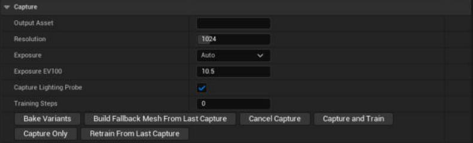
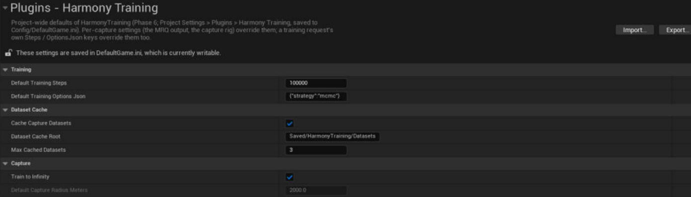

# Capture and Train

With the [capture rig](02_CaptureRig.md) set up, one button renders the views, trains the splat and saves the asset. This page covers the buttons, what you see while a job runs, the training settings, and how to view the result.

## Before you start

- **Save the level.** The render runs a Play In Editor copy of the level. A level that has never been saved is refused. Unsaved edits to a saved level are included in the render.
- **Stop Play In Editor** if it is running.
- **Stop anything that moves**: wind, particle systems, animation. The scene is not frozen during capture.
- **Check the Rows Summary** on the rig for the shot count and time estimate.
- **Do not start another Movie Render Queue render** while a capture runs.

## The buttons

Select the rig. The buttons are in the **Details** panel under **Capture**.



| Button | What it does |
|---|---|
| **Capture and Train** | Renders every shot, builds and caches the dataset, captures the lighting probe, trains the splat with a live preview and writes the **Output Asset**. |
| **Capture Only** | Renders and caches the dataset without training. Train it later with **Retrain From Last Capture**, from Python, or in an external trainer. |
| **Bake Variants** | Experimental. Captures and trains the base, then captures and bakes every variant option. See [Variants](05_Variants.md). |
| **Retrain From Last Capture** | Trains the **Output Asset** again from the newest capture of this level. Nothing is rendered. |
| **Build Fallback Mesh From Last Capture** | Builds simplified static meshes from the newest capture. See [Fallback Mesh](07_FallbackMesh.md). |
| **Cancel Capture** | Stops a running job. |

If a job cannot start, a red notification says why. The common reasons:

| Message | What to do |
|---|---|
| `a capture job is already running (Cancel Capture stops it)` | Wait, or cancel the running job. |
| `a training session is running: wait for it or cancel it` | Same. |
| `stop Play In Editor first` | Stop PIE and press the button again. |
| `save the level first ...` | Save the level. |
| `the rig has no shots ...` | Give the rig an include box, and check the pattern settings, exclude boxes and **Shot Set**. |
| `no earlier capture of <level> for <asset> to reuse ...` | **Retrain From Last Capture** found no cached capture. Run **Capture Only** or **Capture and Train** first. |

## What happens during a job

A notification in the corner of the editor shows progress for the whole job and has its own **Cancel** button.

1. **Rendering.** `Harmony: rendering 4324 views (base)`. A Play In Editor render window opens while Movie Render Queue renders the shots. The job is built for you: deferred rendering at **Resolution** squared, **Temporal Samples** per shot, no anti-aliasing, and 32 warm-up frames.
2. **Dataset.** At the end of the render Harmony builds the dataset: camera poses, half-resolution images, depth, masks, a sky-only background, material buffers and up to a million starting points. It also captures the [lighting probe](06_LightingCapture.md) and writes everything to the [dataset cache](04_DatasetCache.md). On foliage-heavy scenes this step can take as long as the render.
3. **Training.** `Harmony: training SPL_Showroom - step 12000 of 100000, PSNR 31.4`. Training runs in the background within a 33 ms frame budget, so the editor stays responsive. You can keep working, but anything that loads the GPU slows training down.
4. **Saving.** `Harmony: saving SPL_Showroom`. The asset is compressed and saved, and the lighting probe is imported into it.
5. **Done.** `Harmony Capture and Train: /Game/Splats/SPL_Showroom trained (OK: steps=..., N=..., time=...s, ... val PSNR mean=... min=...)`.

For more detail, open the **Output Log** and filter on `Harmony capture`. The log categories are `LogHarmonyTrainingEditor` and `LogHarmonyCapture`.

### Live preview

While training runs, the splat appears in the level viewport and sharpens as it trains. It is drawn by a temporary actor that is removed when training ends; nothing is added to your level.

Hide the original scene geometry, or look from a clear spot, to judge the splat on its own. Early steps look blurry and blobby. That is normal.

### Reading the numbers

- **PSNR** in the notification is measured on training views as training goes. It rises quickly and then levels off.
- **val PSNR** in the final message is measured on views held out of training (every 8th image), so it is the honest figure. As a reference, the example scenes in the [overview](01_Overview.md#what-it-costs) reached 33 to 34 dB.
- **N** is the number of splats in the result.

### Cancelling

**Cancel Capture** (or **Cancel** on the notification) stops the render or the training. Two exceptions: a variant option that is being baked finishes first, and an asset that is already being saved finishes saving. In the second case the final message tells you the asset was written.

The folder of a failed capture is removed from the dataset cache automatically.

## Viewing the result

The job writes the asset but does not place it in the level.

1. Find the asset in the Content Browser. By default it is named `SPL_<level name>`, in a `Splats` folder at the top of the content root the level lives in, for example `/Game/Splats/SPL_Showroom`.
2. Drag it into the level, or place a **Harmony Actor** and assign it as the **Splat Data Asset**.
3. Set the actor's location to 0, 0, 0 with no rotation and a scale of 1.

A baked splat is stored in the level's world coordinates, so at the origin it lines up exactly with the scene it was captured from. Hide the original geometry, or load the splat in an empty level, to see it on its own.

To light meshes with the captured lighting and catch their shadows, see [Lighting and Shadows](../Rendering/10_LightingAndShadows.md). For everything else about placing splats, see [Placing Splats](../Rendering/03_PlacingSplats.md).

To get a PLY of a trained asset, right-click it in the Content Browser and choose **Export to PLY...**. The job itself does not write one.

## Training settings

### On the rig

Under **Capture** on the rig:

| Setting | Default | What it does |
|---|---|---|
| **Training Steps** | 0 | Number of training steps. 0 uses the project default (100,000). |
| **Training Options Json** (advanced) | Empty | Extra trainer options as a JSON object, applied on top of the project defaults. |

**How many steps?** More steps give a sharper result up to a point, and cost time roughly in proportion. On an RTX 3090-class GPU, 30,000 steps took a little over three minutes and 100,000 steps about 14 to 17 minutes. Hard-surface scenes such as a showroom or a courtyard looked good at 30,000. Foliage and fine detail benefit from the full 100,000. A sensible way to work: use 30,000 while you tune the rig, then **Retrain From Last Capture** at the default for the final asset.

### Project Settings

**Edit > Project Settings > Plugins > Harmony Training** holds the defaults for every capture in the project. They are saved to `Config/DefaultGame.ini`, so they are shared with your team.



| Setting | Default | What it does |
|---|---|---|
| **Default Training Steps** | 100000 | Steps used when a rig's **Training Steps** is 0. |
| **Default Training Options Json** | `{"strategy":"mcmc"}` | Trainer options every training run starts from. A rig's own options override them key by key. |
| **Cache Capture Datasets** | On | Whether captures made through a manual Movie Render Queue job are cached. The rig's buttons always cache. |
| **Dataset Cache Root** | `Saved/HarmonyTraining/Datasets` | Where caches are written. A relative path is relative to the project folder. Point it at a drive with space. |
| **Max Cached Datasets** | 3 | Caches kept; older ones are deleted after each capture. 0 keeps all. See [Dataset Cache](04_DatasetCache.md#pruning). |
| **Train to Infinity** | On | What a rig on **Project Default** capture radius does: on trains everything the cameras see, off trains only within the radius below. |
| **Default Capture Radius Meters** | 2000 | The radius used when **Train to Infinity** is off. |

### Training options

The options JSON accepts the trainer's own keys. The defaults are tuned and most scenes need none of them. The ones worth knowing:

| Key | Default | What it does |
|---|---|---|
| `cap_max` | 1000000 | Maximum number of splats. Lower it for a lighter asset, raise it (up to the asset limit of 2,097,120) for more detail. |
| `strategy` | `"mcmc"` | How splats are added and moved during training. `"mcmc"` grows the splat count up to `cap_max`. `"default"` keeps the starting count fixed. |
| `antialiased` | true | Trains with an anti-aliasing filter, so the splat holds up when viewed smaller than it was captured. |
| `eval` | true | Measures val PSNR at the end. |

For example, to train a lighter splat, set **Training Options Json** on the rig to:

```json
{"cap_max": 500000}
```

A key the trainer does not know is reported as an error instead of being ignored, so a typo will not pass silently.

After training you can also reduce an asset with decimation; see [Compression and Decimation](../Rendering/05_CompressionAndDecimation.md).

## Retrain From Last Capture

Rendering is the slow part and it does not need repeating to try different training settings. **Retrain From Last Capture** loads the newest cached capture of this level for the rig's **Output Asset** and trains it again with the rig's current **Training Steps** and **Training Options Json**. Expect about a minute to load the dataset before training starts.

Use it to:

- move from a quick preview to a full-length final training,
- try a different splat cap,
- train a capture made with **Capture Only**.

It needs the cache to still exist. See [Pruning](04_DatasetCache.md#pruning).

## Good to know

- **Training again replaces the asset's splats.** Any baked variants are removed, because they were baked for the previous splats, and the lighting probe is replaced by the one from the capture being trained. Bake variants last.
- **Training pauses during Play In Editor** and resumes afterwards.
- **Training images are half the capture resolution.** To train at 1024, capture at 2048, and expect four times the render cost, RAM and disk.
- **The first shots of a bright Lumen interior can be slightly dark.** The capture warms up for a fixed 32 frames, which is not always enough for indirect lighting to settle.
- **A mesh sky dome or volumetric clouds** may look different in the sky-only background pass than in the views. Such scenes train the sky as splats, which is the default.
- **Advanced: manual Movie Render Queue jobs.** The rig drives a Movie Render Queue output called **Harmony Training**. You can add it to your own job (**Settings > + Setting > Harmony Training**) to reach options the rig does not expose, such as depth and background capture or the starting-point sampler. The rig is the supported route; treat the manual one as expert territory.
