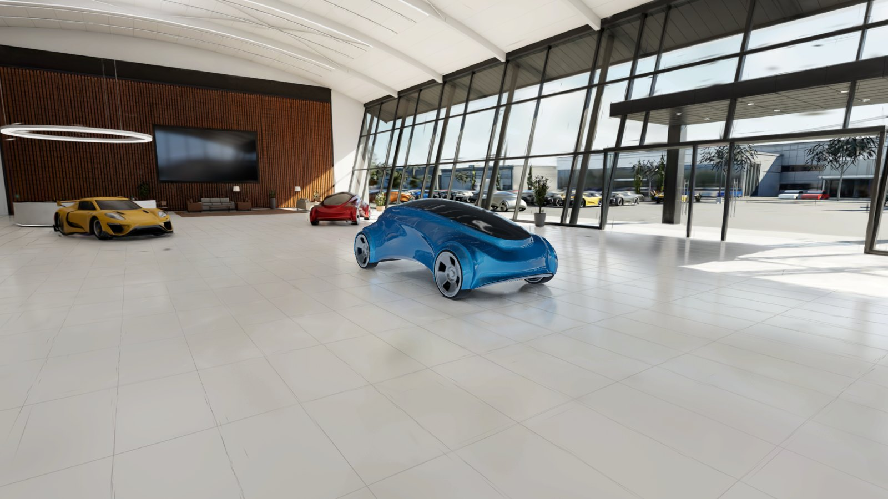

# Lighting Capture

A splat has its lighting baked in, but a mesh you place inside it does not. To make a vehicle or prop look like it belongs, a capture also records the scene's lighting, the ground it stands on and, for shiny floors, the floor's material. This page explains what is captured and how to control it. Using the data at runtime is covered in [Lighting and Shadows](../Rendering/10_LightingAndShadows.md).

## What is captured

Three things are captured alongside the views, all around the **rig's location**:

| Data | What it is | What it is used for at runtime |
|---|---|---|
| **Lighting probe** | A 360 degree HDR image of the scene's light, taken above the rig's origin. | Lights meshes in the level with the scene's own lighting and gives glossy surfaces something to reflect. |
| **Shadow proxy** | The shape of the ground in a 24 m square around the rig's origin, and the sun's share of the light falling on it. | Lets the splat catch the shadows of meshes you put into it. |
| **Floor reflection** | The floor's roughness, specular and metallic values over the same square. | Lets a shiny floor in the splat reflect a mesh standing on it. |

They are stored in the trained asset. Open the asset and look under **Lighting**: **Lighting Probe**, **Shadow Proxy** and **Reflection Proxy** (read only).

This is why rig placement matters: put the rig's origin on the floor where the lit object will stand. See [Placing the rig](02_CaptureRig.md#placing-the-rig).

## Settings

On the rig, under **Capture**:

| Setting | Default | What it does |
|---|---|---|
| **Capture Lighting Probe** | On | Captures the lighting probe. The settings below need it. |
| **Lighting Probe Resolution** (advanced) | 2048 | Width of the probe image; the height is half. 2048 keeps reflections on glossy paint sharp. 1024 is enough for lighting alone at a quarter of the size. 4096 is four times the size. |
| **Lighting Probe Height** (advanced) | 120 cm | Height of the probe above the rig's origin. Set it to about the middle of the object that will be lit. |
| **Capture Shadow Proxy** (advanced) | On | Captures the ground shape and sun share for shadow catching. |
| **Floor Reflection** (advanced) | Auto | Whether to bake the floor's material for reflections. See below. |
| **Variant Lighting Probes** (advanced) | Empty | Per variant option, whether it keeps a probe of its own. See [Variants](#variants). |

If your splat is scenery only and nothing lit will be placed in it, you can turn **Capture Lighting Probe** off. The asset then carries no probe.

## The lighting probe

The probe is rendered from the rig's origin plus **Lighting Probe Height**, looking in every direction.

- **Capture rigs and excluded actors are hidden** for the probe. If you [excluded](02_CaptureRig.md#exclusions) the car, it does not appear in the lighting that later lights the car.
- **It records scene light before exposure**, together with the exposure the views were rendered at. That is what lets a lit mesh come out at the same brightness as the splat.
- **The sun is handled separately.** Its disc is too bright to keep in an image without artefacts, so its direction and strength are stored with the probe and the Harmony Actor can light the level with a matching directional light.
- **The probe point must be in open space.** If it is inside or boxed in by geometry, the Output Log shows a warning that the probe point is inside geometry. Move the rig or change **Lighting Probe Height**.

The base capture renders the probe twice and compares the two. The difference is the capture's noise level, which is used to judge whether a variant option's lighting is really different.

## The shadow proxy

Splats have no surface for a shadow to land on. The shadow proxy gives the Harmony Actor a simple one: a height map of the ground in a 24 m square centred on the rig's origin, captured from above. With it comes a measurement of how much of the ground's light is direct sun, so that a caught shadow is as dark as the scene's own shadows would be, and no darker.

The proxy covers that square only: it reaches 12 m from the rig's origin in each direction.

## Floor reflection

A car in a polished showroom should reflect in the floor. For that, the capture can bake the floor's material from above over the same 24 m square.

| Floor Reflection | Behaviour |
|---|---|
| **Auto** | Bakes it only when a reflection would show: when enough of the floor within a few metres of the rig is smooth and reflective. A polished floor or a wet road qualifies. Gravel, dirt and grass do not. |
| **Always** | Always bakes it. |
| **Never** | No reflections and no extra data. |

With **Auto**, the Output Log and `lighting_probe.json` in the [dataset cache](04_DatasetCache.md) show the measured values and the decision. If the decision is not the one you want, set **Always** or **Never**.

## The exposure chain

For a lit mesh to match the splat, both must be shown at the same exposure. Harmony carries one number through the whole pipeline:

1. **Capture.** The views are rendered at a fixed EV100, chosen as described under [Exposure](02_CaptureRig.md#exposure). The log line `exposure: locked ...` reports it.
2. **Probe.** That EV100 is stored with the lighting probe, whether Harmony locked it or your scene did.
3. **Runtime.** The Harmony Lighting component reads it as **Capture EV100** and can set the level's exposure to match.

You do not need to do anything for this to work. It matters when something looks wrong: if lit meshes are consistently brighter or darker than the splat, check that the level's exposure matches **Capture EV100** on the Harmony Lighting component. See [Lighting and Shadows](../Rendering/10_LightingAndShadows.md).

## Variants

When you [bake variants](05_Variants.md), each option's capture includes its own probe. Whether the option keeps it is decided per option:

| Store | Behaviour |
|---|---|
| **Auto** | Keeps the option's probe when its lighting differs from the base's by more than the capture's noise. A time of day does. A paint colour mostly does not. Otherwise the option uses the base's probe. |
| **Always Store** | Always keeps the option's own probe. |
| **Never Store** | The option uses the base's probe. |

Every option is **Auto** unless you add an entry for it to **Variant Lighting Probes** with its **Set**, **Option** and **Store** choice. The log reports the numbers and the decision for each option.

All options share the base's floor reflection bake.

## Good to know

- **Retraining replaces the probe.** The probe in the asset always comes from the capture the asset was last trained from. If that capture had **Capture Lighting Probe** off, the asset's probe is removed.
- **One rig per level.** The probe is taken at the first capture rig found in the level.
- **The probe is one point.** Lighting is correct at the rig's location and becomes an approximation as a lit object moves away from it. In a scene with strongly varying light, such as a doorway between a dark interior and a sunlit exterior, place the rig where the object will actually be.
- **Splats trained elsewhere have no lighting data.** Only Harmony's own capture job writes the probe, shadow proxy and floor reflection.
