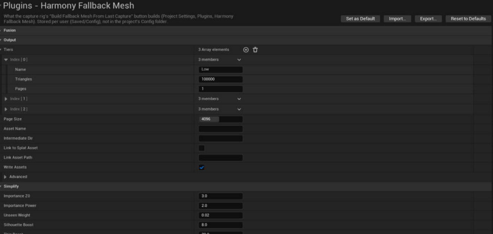

# Fallback Mesh

The fallback mesh builder turns a capture into simplified, textured static meshes that look like the baked scene. They are meant to stand in for the splat on hardware that cannot draw it.

> **Early feature, about to change.** Today the builder produces the meshes and records them on the splat asset, and that is all. Nothing switches to them automatically at runtime; you place them yourself. The feature is being redesigned, so expect this page and the workflow to change.

## What you get

- **Static meshes built from the capture**, not from the trained splat. Harmony fuses the capture's depth into a surface, simplifies it with extra detail kept near the cameras and on silhouettes, and bakes the captured views into textures.
- **Unlit, with the lighting baked in.** The materials are unlit, so the mesh shows the scene exactly as captured and ignores the level's lights.
- **Several tiers.** The defaults are:

| Tier | Triangles | Texture pages (4096 x 4096) |
|---|---|---|
| Low | 100,000 | 1 |
| Mid | 300,000 | 2 |
| High | 750,000 | 4 |

- **A sky dome** on each tier (an extra 1,280 triangles) so there is something behind the scene.
- **A glossy floor**, when the builder detects one: the floor gets a simple cubemap reflection of the scene.
- **Variant options**, when the rig has a [variant source](05_Variants.md) and the options' captures are still in the cache. Where an option moved nothing, it shares the base mesh and only gets new textures.

## Requirements

- Windows with a Shader Model 6 GPU, the same as [baking](01_Overview.md#requirements).
- A cached capture of the level, made with **Capture Only** or **Capture and Train**. The default **Max Cached Datasets** of 3 deletes older caches, so build the fallback before the capture is pruned. See [Pruning](04_DatasetCache.md#pruning).
- For the meshes to be recorded on the splat asset, the trained asset must exist. With **Capture Only** and no trained asset, the meshes are still built; they are just not recorded anywhere.
- Memory: about 15 GB of RAM at peak on the showroom example.

## Building

1. Select the capture rig.
2. In **Details**, under **Capture**, press **Build Fallback Mesh From Last Capture**.

A dialog reads **Building the Harmony fallback meshes (minutes)...**. The build blocks the editor and cannot be cancelled. On an RTX 3090-class GPU the three default tiers of a showroom took about five and a half minutes; each variant option adds four to six minutes. A notification reports **Harmony fallback meshes built** or the error.

If there is no capture to build from, the error is `no capture of <level> in the dataset cache (run Capture Only or Capture and Train first)`.

The build uses the newest base capture of the level for the rig's **Output Asset**, then each option of the rig's **Variant Source** (limited to **Variant Sets to Bake** if set) whose capture exists and is not older than the base.

## What is written

Assets go in the same folder as the splat asset, by default `<content root>/Splats/`:

| Asset | What it is |
|---|---|
| `SM_<Name>_Fallback_<Tier>` | The static mesh of a tier. No collision, Nanite, shadows or lightmaps. |
| `T_<Name>_Fallback_<Tier>_P<n>` | Its texture pages. |
| `MI_...` | Material instances, one per page. |
| `M_HarmonyFallback_Unlit`, `M_HarmonyFallback_FloorCube` | The two parent materials, created in the same folder. |
| `T_..._Cube`, `T_<Name>_Fallback_FloorMap` | The floor's reflection cubemap and map, when a glossy floor was found. |

Variant options go in a subfolder named `<Set>_<Option>`. Building again updates assets of the same name in place.

The meshes are also recorded on the splat asset. Open the Harmony Data Asset and look under **Fallback > Fallback Tiers**: each tier name maps to its mesh and its variant options.

## Using a fallback mesh today

Drag `SM_<Name>_Fallback_<Tier>` into the level and leave it at location 0, 0, 0 with no rotation and a scale of 1. Like a baked splat, the mesh is in the level's world coordinates. Moving it also breaks the glossy floor, which uses world positions.

Two things to know:

- **Switching is up to you.** The **Fallback Tiers** list on the asset is a record. The renderer does not read it. To use a fallback on low-end hardware you need your own logic, for example a level or actor you show when you decide the splat is too expensive.
- **Colours need a neutral post-process to match.** The textures hold final display colours, the same as the capture's images. Unreal's tonemapper and auto exposure are then applied a second time, which shifts the look noticeably. To see the mesh as captured, view it under an unbound Post Process Volume with manual exposure and the look adjustments neutralised: bloom 0, local exposure 1, tone curve amount 0, expand gamut 0, blue correction 0, and vignette, grain and chromatic aberration 0. This is an approximation. The plugin does not ship a ready-made volume or material for it.

Because the mesh is unlit and already tonemapped, it does not combine cleanly with lit content such as a vehicle in the same view. There is no solution for that yet.

## Settings

**Edit > Editor Preferences > Plugins > Harmony Fallback Mesh** holds the builder's settings.

These settings are stored **per user**, not in the project's shared config. They are not shared through source control, and each team member has their own.

The defaults are a good starting point. The settings most worth knowing:

| Setting | Default | What it does |
|---|---|---|
| **Tiers** | Low, Mid, High | The tiers to build. Each has a **Name** (used in asset names), a **Triangles** budget (minimum 1,000) and a number of texture **Pages** (1 to 16). Remove tiers you do not need to save time. |
| **Page Size** | 4096 | Size of each texture page, 256 to 8192. |
| **Asset Name** | Empty | Base name of the assets. Empty uses the first folder of the output path with any leading `Env_` removed, so with the default output folder of a normal project (`/Game/Splats/`) the meshes are named `SM_Game_Fallback_<Tier>`. Set a name for each scene: two scenes whose splats share a folder would otherwise overwrite each other's meshes. |
| **Sky Dome Radius** | 3000 m | Radius of the sky dome. 0 builds none. |
| **Glossy Floor** | On | Detects a glossy floor and gives it a cubemap reflection. |
| **Foliage Hull Closing** | Off | Helps foliage-heavy scenes hold together. Leave it off for hard-surface scenes, where it misfires. |

The page groups the settings into **Fusion**, **Output**, **Simplify**, **Unwrap**, **Bake** and **Glossy Floor** sections. **Set as Default** saves your values as the project's defaults, so teammates start from them.

The remaining settings (fusion, simplification, unwrapping, baking, variant detection) tune the build itself and rarely need changing.

## Limitations

- **No automatic runtime switching.** You place and show the mesh yourself.
- **Unlit and display-referred.** It needs a neutral post-process to match the splat and does not mix with lit content.
- **The build blocks the editor**, shows no progress and cannot be cancelled.
- **Single-sided.** Surfaces are visible from the captured side only.
- **Glossy floor tuning is not per scene.** The reflection's strength and blur use values fitted to one showroom scene.
- **The sky dome is always drawn**, however far the camera is.
- **Not tested on mobile hardware.**
- **This feature has had little interactive testing.** Report anything that does not behave as described here.
