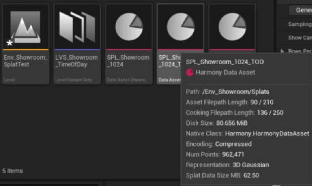
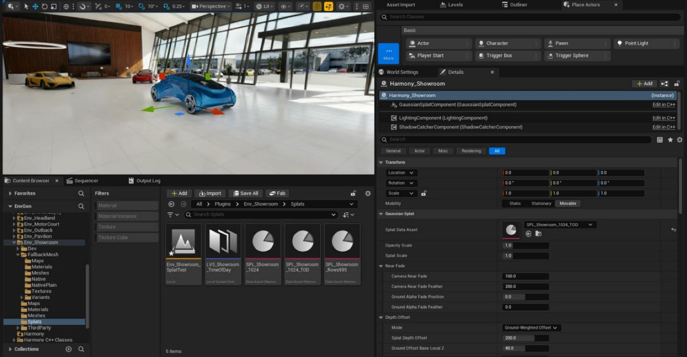
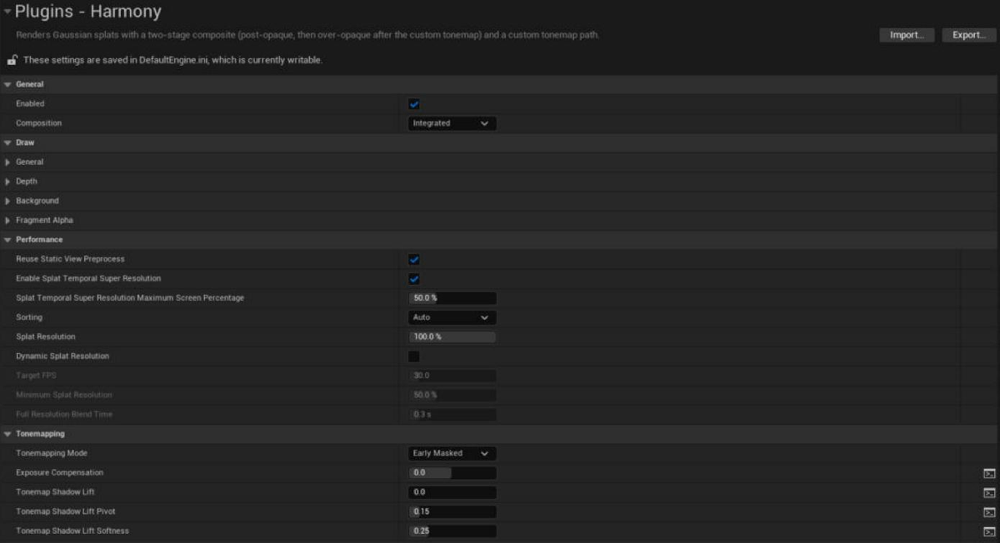

# Render your first splat

This guide takes you from an empty project to a Gaussian splat on screen: install the plugin, import a `.ply`, place it in a level, check the look, and play. It takes about five minutes once you have a splat file.

## Before you start

You need:

- **Unreal Engine 5.9.0.** The plugin binaries only load in the exact engine version they were built for.
- **Windows or macOS.**
- **A Gaussian splat file.** Any 3D Gaussian splatting PLY from the common training or capture tools will do. If you don't have one, export one from the tool you already use, or bake one from an Unreal level with [Bake an Unreal scene](02_BakeAnUnrealScene.md).

### Check your PLY

Harmony reads Gaussian splat PLY files with two constraints:

| Requirement | Why it matters |
|---|---|
| Binary little-endian | ASCII and big-endian PLY files are not read. |
| Spherical harmonics degree 3 | The file must contain the full set of `f_rest_0` to `f_rest_44` properties. Files exported with a lower SH degree are not accepted. |

Most 3D Gaussian splatting tools write exactly this by default. If your tool has an export option for SH degree, choose 3.

Harmony also imports `.spz`, `.sog`, `.splat`, `.ksplat` and `.npz` files. The steps below are the same for all of them. See [Importing](../Rendering/02_Importing.md) for what each format supports.

## 1. Install the plugin

1. Close the Unreal editor.
2. Download the release zip for your engine version, for example `Harmony-0.0.1-UE5.9.zip`, from the [Releases page](https://github.com/restlesspixels/Harmony/releases).
3. Extract it into `<YourProject>/Plugins/`. The zip contains a `Harmony` folder, so the plugin ends up at `<YourProject>/Plugins/Harmony/`. Create the `Plugins` folder if your project doesn't have one.
4. Open your project.

There is nothing to compile, and the plugin is enabled by default. To confirm it loaded, open **Edit > Plugins** and search for **Harmony**.

If you prefer git, or something goes wrong, see [Installation](../Rendering/01_Installation.md).

## 2. Import the splat

1. Open the **Content Browser** and pick a folder for the asset.
2. Drag your `.ply` file from your file manager into the Content Browser. You can also use the **Import** button.
3. Wait for the progress dialog to finish. It steps through parsing the file, building the asset and saving it.

You now have a **Harmony Data Asset**. Harmony saves it automatically, so there is no unsaved asset to remember.

Good to know:

- **Assets are compressed on import by default.** Compressed assets are much smaller and are what you normally want. You can change this under **Edit > Project Settings > Plugins > Harmony Import**. See [Compression and decimation](../Rendering/05_CompressionAndDecimation.md).
- **Units and axes are converted for you.** Splat files are usually in metres with a different up axis. Harmony converts them to Unreal's centimetres and Z-up on import.
- **There is no thumbnail preview.** Hover over the asset to see its splat count, encoding and size.

## 3. Place it in the level

The quick way is to drag the Harmony Data Asset from the Content Browser into the level viewport. This creates a **Harmony Actor** with the asset already assigned.

You can also do it by hand:

1. Open the **Place Actors** panel and search for **Harmony Actor**.
2. Drag it into the level.
3. Select it. In the **Details** panel, under **Gaussian Splat**, set **Splat Data Asset** to your asset.

The splat appears in the viewport straight away.

## 4. Position the splat

Splats are rarely centred on their origin, and captures from real-world tools often come in tilted or at an arbitrary height. Expect to adjust the actor.

1. Select the Harmony Actor in the **Outliner**. Clicking the splats in the viewport does not select the actor, so use the Outliner.
2. Press **F** with the viewport focused to frame it. If the view lands somewhere unexpected, fly the camera to find the splat: it can be far from the actor's pivot.
3. Use the move and rotate tools to put the ground of the splat on your level's ground and to face it the way you want.

Tips:

- If the splat disappears when the camera gets close, that is the **Near Fade**. By default splats within 100 cm of the camera fade out so they don't smear across the screen. Lower **Camera Near Fade** on the actor if you need to get closer.
- A splat baked with Harmony is already in the level's world space. Place its actor at the origin with no rotation and it lines up with the level it was captured from.

## 5. Check the look

Harmony's defaults are chosen so a splat looks the way it was captured, and still mixes with Unreal content. It is worth knowing the two settings that control this. Both are in **Edit > Project Settings > Plugins > Harmony**.

| Setting | Default | What it does |
|---|---|---|
| **Composition** | Integrated | How splats combine with Unreal content. Integrated draws splats both behind and in front of Unreal geometry and translucency, with feathered edges between them. |
| **Tonemapping Mode** | Early Masked | How Unreal's tonemapper treats splats. Early Masked tonemaps Unreal content but leaves the splats alone, so they keep their captured colours. |

A splat already has its final colours baked in. If Unreal's tonemapper ran over it a second time, it would look more contrasty and more saturated than the capture. The default avoids that. Auto exposure also ignores the splat pixels in this mode, so a bright splat does not darken the rest of your scene.

If the splat looks wrong:

- **Colours look crushed or over-saturated.** Check that **Tonemapping Mode** has not been changed to **Stock Tonemapping**.
- **Your meshes look too dark or too bright next to the splat.** The level's exposure doesn't match the splat. A fixed exposure in a post-process volume is the usual fix. For splats baked with Harmony, the Harmony Lighting component does this for you. See [Lighting and shadows](../Rendering/10_LightingAndShadows.md).
- **The splat draws over a mesh that should be in front, or the other way round.** See the **Depth Offset** settings in [Placing splats](../Rendering/03_PlacingSplats.md).

The full list of modes and when to use each is in [Rendering settings](../Rendering/04_RenderingSettings.md).

## 6. Play and package

Press **Play**. The splat renders in Play In Editor the same way it does in the viewport.

To ship it, package the project as usual. No extra steps are needed: the Harmony Data Asset is cooked like any other asset that your level references, and the plugin's runtime is included in the build. Splat rendering works in packaged games on Windows and macOS.

## Where next

| To do this | Read |
|---|---|
| Hide or cut away part of a splat | [Placing splats](../Rendering/03_PlacingSplats.md) (Harmony Volume) |
| Make the splat smaller on disk or cheaper to draw | [Compression and decimation](../Rendering/05_CompressionAndDecimation.md) and [Running on low-end hardware](03_LowEndHardware.md) |
| Add meshes that are lit and shadowed to match | [Lighting and shadows](../Rendering/10_LightingAndShadows.md) |
| Bake your own Unreal level into a splat | [Bake an Unreal scene](02_BakeAnUnrealScene.md) |
| Work out why something looks wrong | [Debugging](../Rendering/11_Debugging.md) |

## Good to know

- **Clicking splats doesn't select the actor.** Select Harmony Actors from the Outliner.
- **Hiding the actor stops it drawing.** Both the editor visibility toggle and **Hidden in Game** work as you would expect.
- **You can add the splat to any actor.** Use **Add Component** and choose **Harmony** to put a splat on an existing actor or Blueprint.
- **PLY import is strict.** A file that isn't binary little-endian with SH degree 3 will fail to import. Re-export it from your tool with those options.
  If a file is rejected, Unreal shows its standard *Failed to import* dialog and the **Output Log** gives the reason, for example `Only 'binary_little_endian' PLY files are supported.` or `SH degree 3 import requires f_rest_0..f_rest_44.`
