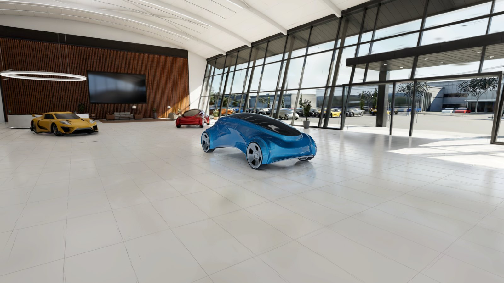
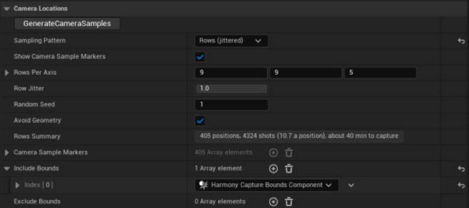
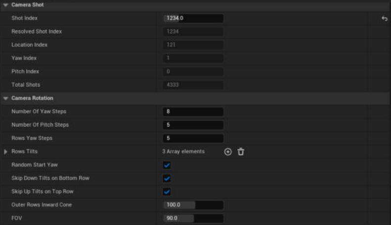
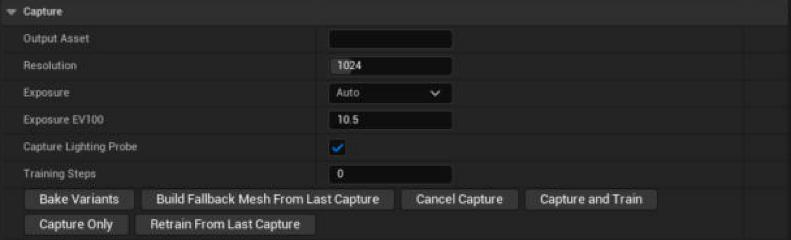
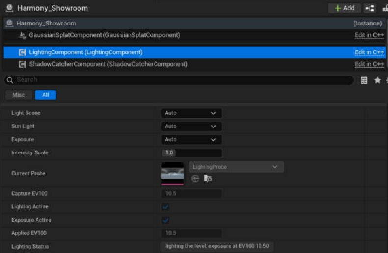

# Bake an Unreal scene

This guide bakes an Unreal level into a Gaussian splat, start to finish. The example is a vehicle showroom: a lit interior about 16 m square, with a car in the middle that we want to keep as a real mesh. The same steps work for any scene.

You will place a Harmony Capture Rig, choose where the cameras go, press one button, and end up with a Harmony Data Asset you can place in any level.

## Before you start

| You need | Notes |
|---|---|
| Windows with an SM6-capable GPU | Baking is an editor tool. It runs on D3D12 or Vulkan with Shader Model 6. It has only been tested on an RTX 3090-class GPU. |
| Free memory | The capture is held in RAM while training. Around 4,500 views takes roughly 7 GB. |
| Free disk space | Each capture is cached on disk. Expect about 3.6 GB for around 4,000 views. |
| Time | Roughly half an hour to an hour for a scene of this size. See [What to expect](#what-to-expect). |

Baking renders the level with Movie Render Queue, so the result looks the way your level looks. Get the lighting and materials to a state you are happy with first.

For the background on how baking works, see the [Baking overview](../Baking/01_Overview.md).

## 1. Save the level

Open the level you want to bake and save it. The capture refuses to start on a level that has never been saved, and shows "save the level first".

Unsaved edits to a saved level are fine. The capture renders the level as it is in the editor right now.

## 2. Place a Harmony Capture Rig

1. Open the **Place Actors** panel and search for **Harmony Capture Rig**.
2. Drag it into the level.
3. Move it to the middle of the area you care about, on the floor. In the showroom that is where the car stands.

The rig's position matters for more than the cameras. It is also the point where Harmony records the scene's lighting, and the centre of the ground area that will later catch shadows and reflections. Put it where you expect to place meshes afterwards.

A new rig shows a green box with small green cubes inside it. The box is the view area. Each cube is a camera position.

Keep one rig per level. If a level has several, only the first one is used for exclusions and lighting capture.

## 3. Size the include box over the viewing area

The include box says where the capture cameras stand. It should cover the space your viewers' camera will move through, not the whole building.

1. Select the rig. In the **Details** panel, open **Camera Locations**.
2. Expand **Include Bounds**, then the first entry, then **Shape**.
3. Set **Location** and **Box Extent** so the green box covers the walkable area.

The values are half-sizes in centimetres. The default extent of 800 × 800 × 125 with its centre 145 cm up is a 16 × 16 m area from 20 cm above the floor to 2.7 m. That suits the showroom as it is.

Why this matters: a splat looks best from where the cameras were. Views from inside the box will be sharp. Step well outside it and you will see soft or missing areas. Make the box as large as the area people will actually stand in, and no larger.

If part of the box should have no cameras, such as a pillar or a locked room, add an entry to **Exclude Bounds**. Exclude boxes are drawn in red.

## 4. Choose the camera pattern

**Sampling Pattern**, also in **Camera Locations**, decides how camera positions fill the box. New rigs use **Rows (jittered)**, which is the right choice for a room you walk around in.

| Setting | Default | What it does |
|---|---|---|
| **Rows Per Axis** | 9, 9, 5 | Camera positions along X, Y and Z, spread from edge to edge of the box. Resizing the box changes the spacing, not the count. |
| **Row Jitter** | 1 | Randomly offsets each position inside its cell. Jitter avoids the regular grid artefacts that evenly spaced cameras cause. |
| **Random Seed** | 1 | Makes the jitter repeatable. Leave it alone if you plan to bake variants later, because they rely on the same positions. |
| **Avoid Geometry** | On | Moves positions that land inside geometry. A position with no free space nearby is dropped. |

Each position takes several shots at different headings and tilts. You rarely need to change these. They are under **Camera Rotation** if you do.

The other two patterns, **Grid** and **Radial**, are described in [Capture rig](../Baking/02_CaptureRig.md).

## 5. Read the Rows Summary

**Rows Summary** is a read-only line under the pattern settings. It tells you what the capture will cost before you commit to it. With the defaults, on an include box that overlaps no geometry, it reads:

> 405 positions, 4324 shots (10.7 a position), about 40 min to capture

If **Avoid Geometry** drops cells, the line ends with how many were dropped.

Check three things:

- **Shots.** Around 3,000 to 5,000 is a good range for a room. Fewer trains faster but leaves gaps. More costs render time, RAM and disk.
- **Minutes.** This is an estimate of the render only. Training comes on top.
- **Cells dropped.** If the line ends with a count of dropped cells, **Avoid Geometry** found no free space for those positions. A few is normal in a furnished room. A lot means the box sits mostly inside geometry.

To change the shot count, change **Rows Per Axis**. Dropping the vertical count from 5 to 3 is the quickest way to cut a capture down for a first test.

## 6. Scrub through the shots

Before spending half an hour rendering, look at what the cameras will see.

1. With the rig selected, find **Shot Index** in the **Camera Shot** category.
2. Pilot the rig, or watch its camera preview, and drag **Shot Index** up and down.

Each value is one shot. You are looking for cameras inside walls or furniture, cameras that only see a blank surface a few centimetres away, and areas that no camera ever looks at. **Total Shots** shows how many there are.

If something is wrong, adjust the box or add an exclude box and scrub again. The markers update as you edit.

## 7. Exclude the hero prop

The car is going to be a real, lit mesh at runtime, so it should not be baked into the splat. Tag it and Harmony leaves it out.

1. Select the car actor.
2. In its **Details** panel, find **Tags** under **Actor** (it is in the advanced section).
3. Add a tag named `HarmonyExclude`.

Excluded actors are masked out of every training image, and any splats that form inside their bounds are removed. They are also hidden when the lighting is recorded, so the car does not appear in its own reflections.

You can list actors directly instead: add them to **Excluded Actors** in the rig's **Training** category. The tag name itself is set by **Exclude Actor Tag** in the same category.

Exclude anything that will move, animate or be swapped at runtime. Leave everything else in.

## 8. Set the exposure

A splat stores final colours, so the capture needs one fixed exposure for every shot. If exposure drifted between shots, the same wall would be recorded at different brightnesses and the splat would flicker as you move.

In the rig's **Capture** category:

| Setting | Default | What it does |
|---|---|---|
| **Exposure** | Auto | **Auto** keeps a fixed exposure that your level already sets. If the level has none, it locks the exposure for you. **Locked** always uses **Exposure EV100**. **Scene** leaves exposure entirely to the level. |
| **Exposure EV100** | 10.5 | The exposure to lock at when the level doesn't set one. |

For the showroom, leave **Exposure** on **Auto** and **Exposure EV100** at 10.5. The showroom is brightly lit. As a rough guide, dim interiors sit around 6 to 9, overcast exteriors around 11 to 12, and full sun around 13 to 15.

If your level has a post-process volume with a fixed exposure that you like, you don't need to do anything. Auto uses it.

The exposure is recorded with the capture. Later it lets Harmony light your meshes to the same level as the splat. See [Lighting capture](../Baking/06_LightingCapture.md).

## 9. Set the Output Asset

Still in **Capture**, **Output Asset** is where the trained splat is saved. If you leave it empty, Harmony uses `Splats/SPL_<MapName>` under your content root, for example `/Game/Splats/SPL_Showroom`.

Two more settings in this category are worth a look for a first bake:

| Setting | Default | What it does |
|---|---|---|
| **Resolution** | 1024 | The size of each rendered view, in pixels. Training uses images at half this size. |
| **Training Steps** | 0 | How long to train. 0 uses the project default of 100,000 steps. For a first look, 30,000 is much faster and already gives a good result on a scene like this. |

## 10. Capture and Train

1. Make sure Play In Editor is stopped.
2. Press **Capture and Train** in the **Capture** category.

Everything from here is automatic:

1. **Rendering.** A render window opens and Movie Render Queue renders every shot. The notification reads "Harmony: rendering N views (base)".
2. **Building the dataset.** Harmony works out camera poses, depth and starting points, and writes the capture to the dataset cache on disk.
3. **Training.** The notification changes to "Harmony: training SPL_Showroom - step 1200 of 30000, PSNR 27.4" and counts up.
4. **Saving.** The asset is written and saved, and the recorded lighting is stored in it.

Leave the editor alone while the render window is open. Don't start a second render of any kind at the same time.

To stop, press **Cancel** on the notification or **Cancel Capture** on the rig.

## 11. Watch the live preview

Once training starts, the splat appears in the level viewport and sharpens as the steps go by. It starts as a coarse cloud and resolves into the room over the first few thousand steps.

Training runs in the background, so you can fly around the preview while it works. Use it to spot problems early: a corner no camera covered, or an exposure that is clearly wrong. If you see one, cancel, fix the rig and start again rather than waiting for the full run.

PSNR in the notification is a measure of how closely the splat matches the rendered views. Higher is better. It climbs quickly at first and then levels off.

### What to expect

These are measurements from an RTX 3090-class GPU. Treat them as examples, not promises. Your scene and hardware will differ.

| Scene | Views | Render | Dataset build | Training | Total | Result |
|---|---|---|---|---|---|---|
| Showroom interior | about 4,300 | about 40 min (the rig's estimate) | a few minutes | 30,000 steps in about 190 s | | About 620,000 splats, validation PSNR 34.2 dB |
| Motor court exterior | 4,212 | 16.8 min | 8 min | 30,000 steps in 198 s | 29 min | Validation PSNR 33.0 dB, 59 MB asset, 3.6 GB cache |
| Foliage-heavy exterior | 4,200 to 4,800 | 21 to 34 min | 17 to 45 min | 100,000 steps in 14 to 17.5 min | 60 to 78 min | |
| Small test | 234 | | | | about 3.3 min | |

When it finishes, the notification shows a summary with the step count, the number of splats, the time taken and the validation PSNR.

## 12. View the result

The capture doesn't place the splat for you. It is easiest to judge in a clean level, away from the original geometry.

1. Create a new empty level and save it.
2. Drag a **Harmony Actor** in from **Place Actors**.
3. Set its location to 0, 0, 0 and its rotation to 0, 0, 0.
4. Set **Splat Data Asset** to the new asset, for example `SPL_Showroom`.

A baked splat is stored in the world space of the level it came from. With the actor at the origin and unrotated, everything is exactly where it was in the original level. That makes it simple to copy the car across at the same transform.

## 13. Check the Harmony Lighting component

The Harmony Actor has a **Harmony Lighting** component. It reads the lighting recorded during the bake and lights the level with it, so meshes you add match the splat. In an empty level it works without any setup.

1. Select the Harmony Actor and pick its **LightingComponent** in the component list.
2. Read **Lighting Status** in the **Lighting** category.

| Lighting Status says | What it means |
|---|---|
| "lighting the level, exposure at EV100 …" | Working. The level is lit from the bake and the exposure matches the capture. |
| "the level has its own sky light (set Light Scene to Always to take over)" | Your level already has a sky light, so Harmony stepped back. Remove the sky light, or set **Light Scene** to **Always**. |
| "the asset has no lighting probe" | The asset was baked without lighting capture, or it is an imported splat. |

Now add the car. Copy it from the original level and paste it at the same transform. It should sit in the showroom lit the same way as its surroundings.

To have it cast a shadow and reflect in the floor, add the tag `HarmonyShadowCaster` to the car actor. The Harmony Actor's Shadow Catcher component picks up tagged actors and draws their shadows onto the splat. See [Lighting and shadows](../Rendering/10_LightingAndShadows.md).

## Optional: retrain without re-rendering

Rendering is the slow part, and you don't need to repeat it to change training settings. Every capture is kept in the dataset cache.

1. Open the original level and select the rig.
2. Change **Training Steps**, for example from 30,000 to the full 100,000.
3. Press **Retrain From Last Capture**.

Harmony loads the newest capture of this level from the cache, which takes about a minute, and trains again into the same **Output Asset**. Nothing is rendered.

Good to know:

- Retraining replaces the splats in the asset. Any variants baked into it are removed and need to be baked again.
- The lighting probe, shadow and floor reflection data are imported again from the same cache, so the asset keeps its lighting without a fresh capture.
- The cache keeps the three most recent captures by default and deletes older ones. Change **Max Cached Datasets** under **Edit > Project Settings > Plugins > Harmony Training** if you need more. See [Dataset cache](../Baking/04_DatasetCache.md).

## Optional: build a fallback mesh

A fallback mesh is a simplified, textured, unlit mesh of the same scene, built from the capture. It is meant for hardware that can't draw the splat.

1. Select the rig in the original level.
2. Press **Build Fallback Mesh From Last Capture**.

The editor is blocked while it builds, and there is no cancel. For the showroom, building the default three tiers took about three and a half to five and a half minutes and peaked at around 15 GB of RAM.

The meshes are saved next to the splat asset (by default in `/Game/Splats/`) as `SM_<Name>_Fallback_Low`, `_Mid` and `_High` (100,000, 300,000 and 750,000 triangles). Unless you set an **Asset Name** in the fallback settings, `<Name>` is the first folder of that path with any leading `Env_` removed, so in a normal project the meshes are `SM_Game_Fallback_Low`, `SM_Game_Fallback_Mid` and `SM_Game_Fallback_High`. To look at one, drag it into a level and leave it at the origin with no rotation.

Harmony does not switch to a fallback mesh by itself yet. You place it yourself. [Running on low-end hardware](03_LowEndHardware.md) covers how to use it today, and [Fallback mesh](../Baking/07_FallbackMesh.md) has the full reference.

## Troubleshooting

| Problem | Likely cause |
|---|---|
| "save the level first" | The level has never been saved. Save it and try again. |
| "stop Play In Editor first" | A Play In Editor session is running. |
| The first few shots are darker than the rest | Lumen had not settled when the render began. This shows up in bright Lumen interiors. |
| Moving things look smeared | The scene is not frozen during capture. Wind, particles and animation keep moving. Turn them off or exclude those actors. |
| Glass or sky looks wrong | See the capture radius notes in [Capture rig](../Baking/02_CaptureRig.md). |
| Fine ground texture looks soft | Training runs at half the render resolution. Raise **Resolution** if you have the memory and time for it. |
| The splat is not where the level was | The Harmony Actor is not at the origin, or it is rotated or scaled. |

## Where next

- [Capture rig](../Baking/02_CaptureRig.md): the other patterns, custom views and capture radius.
- [Capture and train](../Baking/03_CaptureAndTrain.md): every button and training option.
- [Baking variants](../Baking/05_Variants.md): bake a second time of day or material option into the same asset.
- [Automation](../Baking/08_Automation.md): run captures from Python.
