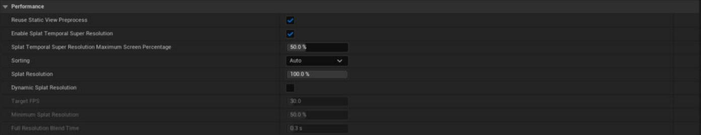
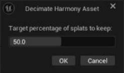

# Running on low-end hardware

Gaussian splats are drawn as hundreds of thousands of overlapping, blended quads, so their cost is mostly GPU fill. This guide lists the settings that make them cheaper, in the order worth trying, and explains what each one trades away.

Splat rendering has been tested on Windows desktop GPUs and on an Apple M1. Nothing here is a promise about a particular device. Measure on the hardware you are targeting.

## Measure first

Find out what the splats cost before changing anything.

- Type `stat Harmony` in the console for the plugin's own timings and counts.
- Use `stat GPU` and `stat unit` to see whether the frame is limited by the GPU at all.
- In the viewport, **View Mode > Buffer Visualization > Harmony Splat Overdraw** shows where splats pile up on screen. Bright areas are where the cost is.

See [Debugging](../Rendering/11_Debugging.md) for the other views.

## Where the cost comes from

| Cost | Driven by | Reduced by |
|---|---|---|
| Fill and blending | Pixels covered × layers of splats over each pixel | Splat resolution, culling, decimation |
| Sorting and per-splat work | Number of splats | Decimation, culling, the static view cache |
| Composition passes | Mixing splats with Unreal content | Composition mode |
| Memory and load time | Number of splats, encoding | Compression, decimation |

The quick wins are below, roughly in order of how much they save for how little they cost in quality.

## 1. Lower the splat resolution

Splats are soft by nature, so they survive being drawn at a lower resolution better than hard-edged geometry does. These settings are in **Edit > Project Settings > Plugins > Harmony**, under **Performance**.

| Setting | Default | What it does |
|---|---|---|
| **Splat Resolution** | 100% | The resolution of the splat layer on each axis, relative to the render resolution. Splats are drawn at this size and scaled up. Unreal content keeps the full resolution. 50% draws a quarter of the pixels. |
| **Dynamic Splat Resolution** | Off | Lowers the splat resolution only while the camera is moving, to hold a target frame rate. When the camera stops, the splats are drawn once at full resolution. |
| **Target FPS** | 30 | The frame rate Dynamic Splat Resolution tries to hold. It only lowers the resolution when the GPU is over this budget. |
| **Minimum Splat Resolution** | 50% | The lowest resolution Dynamic Splat Resolution may use. |
| **Full Resolution Blend Time** | 0.3 s | How long the ramp back to full resolution takes when the camera stops. Each frame of the ramp redraws the splats, so longer ramps cost more. 0 switches at once. |

How to choose:

- **Fixed Splat Resolution** suits a camera that never stops, such as a driving or fly-through view, and scenes where depth of field blurs the splats anyway. Try 75%, then 50%.
- **Dynamic Splat Resolution** suits viewers and configurators, where the camera orbits and then rests. Motion hides the lower resolution, and the image is sharp whenever it is still.

You can use both. Dynamic Splat Resolution works downwards from the Splat Resolution value.

## 2. Keep the static view cache on

**Reuse Static View Preprocess** is on by default, and you should leave it on. While the camera and the splats are not changing, Harmony reuses the previous frame's sorted and drawn splats rather than doing the work again. A still camera then costs very little.

This is why Dynamic Splat Resolution can afford a full-resolution frame when the camera stops. It is drawn once and reused.

## 3. Check Splat Temporal Super Resolution

| Setting | Default | What it does |
|---|---|---|
| **Enable Splat Temporal Super Resolution** | On | Lets Unreal's TSR or TAA recover extra detail in the splats when the project is rendering at a low screen percentage. |
| **Splat Temporal Super Resolution Maximum Screen Percentage** | 50 | The feature only switches on when the screen percentage is at or below this value. |

This is a quality feature with a cost. While it is active, the splats have to be redrawn every frame, even when the camera is still, so the static view cache saves less.

With the default threshold it only activates at a screen percentage of 50 or lower. If you run at a low screen percentage to save GPU time, you are in that range. Then you have a choice:

- Leave it on for a sharper image when upscaling.
- Turn it off to get the full benefit of the static view cache when the camera is still.

## 4. Use a simpler composition mode

**Composition**, in the **General** category of the same settings page, controls how much work goes into mixing splats with Unreal content.

| Mode | What it does | Use it when |
|---|---|---|
| **Integrated** (default) | Splats draw both behind and in front of Unreal geometry and translucency, with feathered edges. | You need meshes properly inside the splat, including glass and effects. |
| **Background Plate** | Splats are a background layer only. Unreal geometry and translucency always draw on top. Skips the late splat stage, the edge feathering and the translucency split. | The splat is an environment and nothing in it needs to pass in front of your meshes. |
| **Splats Only** | Assumes there is no Unreal content at all. Skips the coverage mask and Harmony's tonemap pass. Splats are never tonemapped. | The level is purely a splat viewer. |

Background Plate and Splats Only exist for low-power devices. What you give up:

- **Background Plate.** Splats never cover a mesh. A car standing behind a baked pillar draws in front of the pillar. Check your camera paths for cases like that.
- **Splats Only.** Any mesh, UI drawn in the world, or effect is treated as if it were splat. Use it only when there really is nothing else in the view.

## 5. Decimate the asset

Decimation reduces the splat count by merging splats that are close together and look alike. It is lossy. Fewer splats means less sorting, less fill, less memory and a smaller package. It is the only setting here that also reduces download size.

There are two ways to do it.

**On an existing asset**

1. Right-click the Harmony Data Asset in the **Content Browser**.
2. Choose **Decimate…**.
3. Enter the percentage of splats to keep, from 1 to 99. The default is 50.

This creates a new asset beside the original, named `<Name>_Decimated<NN>`. The original is untouched, so you can make several and compare them side by side.

**At import**

Set **Decimation Target Ratio** under **Edit > Project Settings > Plugins > Harmony Import**. The default of 1.0 keeps everything. 0.5 keeps half. It applies to every import from then on, so set it back when you are done.

Good to know:

- **Decimation removes variants.** A decimated asset has no variant sets. If you need variants on a low-end build, this option is not available to you yet.
- **It is not available for BB splats.**
- **Start at 50% and look at it.** Scenes with large flat surfaces tolerate heavy decimation. Fine detail such as foliage and text goes first.
- **Keep assets compressed.** Compression is on by default at import and is what you want for memory and package size. A decimated copy of a compressed asset is compressed too.

See [Compression and decimation](../Rendering/05_CompressionAndDecimation.md).

## 6. Tighten culling

Culling drops splats before they are sorted and drawn. These settings are in the **Culling** categories of **Edit > Project Settings > Plugins > Harmony**. They take effect immediately, so adjust them while watching the viewport and `stat Harmony`.

| Setting | Default | What it does | Trade-off |
|---|---|---|---|
| **Splat Min Alpha** | 0.06 | Drops whole splats that are fainter than this. | Raise it to remove faint haze splats. Too high and soft areas thin out or show holes. |
| **Use Distance-Based Splat Min Alpha** | Off | Uses a low threshold near the camera and a higher one far away, blended between two distances. | Lets you cull harder in the distance, where it shows least. |
| **Min Screen Radius (px)** | 0 | Drops splats smaller than this many pixels on screen. | Try 0.5 to 1 to remove sub-pixel splats in distant areas. Higher values thin out distant detail. |
| **Base Frustum Padding** | 1.2 | How far outside the screen edge splats are kept. | Lower values cull more at the edges. Too low and large splats pop at the screen border. |
| **Splat Tail Cutoff** | 1.8 | How far each splat's soft edge extends. It is in **Draw > Fragment Alpha**. | Lower values shrink every splat's footprint and cut overdraw. Too low and splats get hard edges and gaps appear. |

Change one at a time. The right values depend on the asset.

### Cull whole regions with a Harmony Volume

If part of a splat is never seen from your camera paths, remove it from the work entirely. Place a **Harmony Volume Actor** over the region and set **Evaluation Stage** to **Preprocess**. (**Effect Mode** is hidden at that stage, because Preprocess always removes splats.) Splats whose centres are inside the volume are dropped before sorting and drawing.

A Harmony Volume affects every splat in the level. See [Placing splats](../Rendering/03_PlacingSplats.md).

## 7. Use Near Fade

Splats close to the camera cover a lot of the screen, and they are the most expensive ones to draw. Each Harmony component has a **Near Fade** group under **Gaussian Splat** that fades them out. The main reason to use it is to stop huge, blurry splats filling the view when the camera passes close to a surface.

| Setting | Default | What it does |
|---|---|---|
| **Camera Near Fade** | 100 | Splats within this distance of the camera, in centimetres, are fully transparent. |
| **Camera Near Fade Feather** | 200 | The distance over which they fade back in beyond that. 0 is a hard cut. |
| **Ground Alpha Fade Position** | 0 | A height. Splats at or below it are kept even when they are inside the near fade distance, so the floor under the camera does not vanish. |
| **Ground Alpha Fade Feather** | 0 | How gradually that exemption fades out above the height. |

The defaults already remove the worst case. If your camera stays well away from surfaces, raising **Camera Near Fade** costs nothing visually. If the camera moves close to walls or props, larger values will show as objects dissolving as you approach.

The saving is smaller than the visual change suggests. The fade is worked out per pixel while drawing: faded splats are still sorted and rasterised, and only their fully transparent pixels are thrown away before blending. To drop splats near the camera before any of that work, use **Near Cull Distance** in **Culling > Frustum** instead, which removes every splat closer than that distance with a hard cut.

## 8. Sorting

**Sorting**, under **Performance**, chooses where splats are depth sorted.

| Mode | What it does |
|---|---|
| **Auto** (default) | Sorts on the CPU while the frame is limited by the GPU, and on the GPU otherwise. It holds each choice long enough not to flip back and forth. |
| **GPU** | Always uses the compute sort. |
| **CPU** | Always sorts on a worker thread, which frees GPU time. |

Auto is the right setting in most cases. On a device with a weak GPU and spare CPU cores, try **CPU** and compare.

## 9. The fallback mesh

For hardware that can't run the splat renderer at an acceptable rate at all, Harmony can build a conventional mesh of a baked scene. This only applies to splats you baked from an Unreal level with Harmony, because the mesh is built from the capture, not from the splat.

What you get:

- Simplified, textured static meshes in three tiers by default: Low (100,000 triangles), Mid (300,000) and High (750,000), with one, two and four 4096 × 4096 texture pages.
- The lighting baked into the textures. The materials are unlit.
- A sky dome and, for glossy floors, an approximated floor reflection.

How to build one:

1. Select the **Harmony Capture Rig** in the level you baked.
2. Press **Build Fallback Mesh From Last Capture** in the **Capture** category.

The build needs Windows with an SM6-capable GPU, and the capture must still be in the dataset cache. It blocks the editor for a few minutes. The meshes are saved in the same folder as the splat asset, named `SM_<Name>_Fallback_<Tier>`. Unless you set an **Asset Name**, `<Name>` is the first folder of the output path with any leading `Env_` removed, so in a normal `/Game` project you get `SM_Game_Fallback_Low`, `_Mid` and `_High`. Details are in [Fallback mesh](../Baking/07_FallbackMesh.md).

### Using it today

Harmony does not switch between the splat and the fallback mesh. The meshes are recorded on the splat asset under **Fallback > Fallback Tiers**, but nothing loads or shows them at runtime yet. You place and switch them yourself:

1. Drag `SM_<Name>_Fallback_<Tier>` into the level.
2. Leave it at the origin with no rotation, the same as the Harmony Actor for that bake. The mesh is in the capture's world space, and the glossy floor stops working if you move it.
3. Show the mesh and hide the Harmony Actor on the hardware that needs it. How you decide that, for example by a quality setting or a separate level, is up to your project.

What to expect:

- **Colours need care.** The textures hold final, display-ready colours, like the splat does. With Unreal's default tonemapper and auto exposure they will look wrong. As a starting point, use a post-process volume with manual exposure and turn off bloom, vignette, grain and the tone curve. Harmony does not ship a ready-made setup for this.
- **It doesn't mix with lit content yet.** There is no solution for showing lit meshes correctly beside a fallback mesh.
- **The meshes are single-sided and unlit**, with no collision, Nanite or shadow casting.
- **It has not been tested on mobile hardware or with mobile texture formats.**

## A suggested order

1. Measure with `stat Harmony` and the overdraw view.
2. Turn on **Dynamic Splat Resolution**, or lower **Splat Resolution** if the camera never rests.
3. If nothing needs to pass behind the splat, switch **Composition** to **Background Plate**.
4. Decimate to 50% and compare. Go lower if it holds up.
5. Raise **Min Screen Radius (px)** and **Splat Min Alpha** a little at a time.
6. Cull unseen regions with a Preprocess **Harmony Volume**.
7. If that is still not enough, build a fallback mesh and place it by hand.

## Limitations

- These settings are project-wide, apart from Near Fade and the Harmony Volume. There are no per-platform or per-quality-level presets built in. Most of them are backed by `r.Harmony.*` console variables (see [Debugging](../Rendering/11_Debugging.md)): every **Culling** and **Draw** row except **Splat Pixel Radius**, plus **Composition**, **Sorting**, **Splat Resolution** and the **Dynamic Splat Resolution** rows. Harmony sets those variables at project-setting priority, so Unreal's usual per-platform overrides win over them: a device profile's `CVars` in `DeviceProfiles.ini`, or a `[SystemSettings]` section in a platform's `Engine.ini`. **Tonemapping Mode**, **Splat Pixel Radius**, **Reuse Static View Preprocess** and the **Splat Temporal Super Resolution** rows have no console variable and cannot be overridden per platform.
- Decimated assets lose their variants.
- The fallback mesh has no runtime switching and no mobile testing.
- Harmony has not been validated on mobile, VR or web targets.
