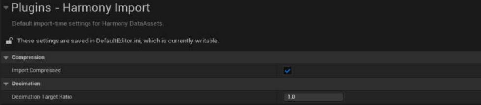
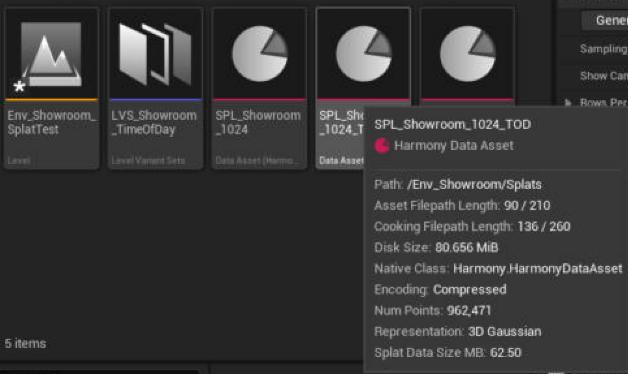

# Importing Splats

Harmony imports Gaussian splats from the common file formats and turns each one into a **Harmony Data Asset**. This page lists the formats, what each one needs, and the two import settings.

---

## How to import

1. Open the **Content Browser** and go to the folder you want the asset in.
2. Drag a splat file into the Content Browser, or click **Import** and pick the file.
3. Wait for the progress dialog. Large files take a while: Harmony parses the file, optionally decimates it, compresses it and saves it.
4. A Harmony Data Asset with the file's name appears in the folder.

The importer picks the format from the file extension. **The new asset is saved to disk automatically** at the end of the import; you do not need to save it yourself.

Once imported, drag the asset into a level to see it. See [Placing splats](03_PlacingSplats.md).

---

## Supported formats

| Extension | Format | What Harmony needs |
|---|---|---|
| `.ply` | Gaussian splat PLY (the standard output of most trainers) | Binary little-endian. Must store spherical harmonics up to degree 3, that is, properties `f_rest_0` to `f_rest_44` must all be present. |
| `.ply` | BB Splat PLY (textured billboards) | Detected when `texture_alpha.npz` and `texture_color.npz` sit beside the PLY. See [BB Splat](07_BBSplat.md). |
| `.splat` | Packed binary splat (32 bytes per splat) | Base colour only; no view-dependent colour. |
| `.spz` | Niantic SPZ | Versions 1 to 4. |
| `.ksplat` | GaussianSplats3D KSPLAT | Version 0.1. |
| `.sog` | PlayCanvas SOG | The bundled `.sog` file (a zip archive holding `meta.json` and its images). |
| `.npz` | Quantised web-splat NumPy archive | Only the quantised web-splat layout. Imports directly as Compressed data. |
| `.harmony` | Harmony's own interchange file | Carries a complete Harmony asset, including variants and lighting data. See [.harmony files](08_HarmonyFile.md). |

If your PLY has a lower SH degree or is ASCII, re-export it from your training tool with degree 3 and binary output, or convert it to one of the other formats first.

A `.sog` import needs nothing extra from you. Its images are decoded with FreeImage, a library that ships with the engine on Windows and macOS; Harmony loads it from the engine's own folder the first time you import a `.sog`.

### Units and orientation

Splat files are assumed to be in metres with the usual splat-tool axis convention. On import Harmony converts every format to Unreal's coordinate system and scales metres to centimetres, so a scene that was 10 m wide in the trainer is 1000 Unreal units wide.

Captures are rarely centred or level. After placing the asset, move and rotate the actor to line it up. You do not need to re-import.

---

## Import settings

**Edit > Project Settings > Plugins > Harmony Import**

| Setting | Default | What it does |
|---|---|---|
| **Import Compressed** | On | Compresses the splat data as the last step of the import. Compressed assets are much smaller on disk and are the recommended form for normal use. Turn it off to keep full-precision (Expanded) data. |
| **Decimation Target Ratio** | 1.0 | Fraction of splats to keep (0.01 to 1.0). 1.0 keeps them all. 0.5 keeps about half by merging nearby, similar splats. Runs before compression. |

Both settings affect future imports only. They never rewrite existing assets. They are stored in your project's `Config/DefaultEditor.ini`.

How each format reacts:

| Format | Import Compressed on | Import Compressed off |
|---|---|---|
| Gaussian `.ply`, `.splat`, `.spz`, `.ksplat`, `.sog` | Compressed | Expanded |
| BB Splat `.ply` | Expanded (always) | Expanded |
| `.npz` | Compressed (always) | Compressed |
| `.harmony` | Whatever the file contains | Whatever the file contains |

Decimation on import does not apply to BB Splat files, or to `.npz` files that use sparse indexing (fewer stored shapes than splats). For the details of both operations, and how to run them later on an existing asset, see [Compression and decimation](05_CompressionAndDecimation.md).

---

## After import

- **Hover** over the asset in the Content Browser to see its splat count, encoding (Expanded or Compressed), representation (3D Gaussian or BB Splat) and data size in MB.
- **Double-click** it to open its properties. Almost everything is read-only. See the [Asset reference](06_AssetReference.md).
- **Right-click** it for **Convert to Compressed**, **Decimate...**, **Export to .harmony...** and **Export to PLY...**.
- **Drag** it into the viewport to create a Harmony Actor that shows it.

---

## Good to know

- **No thumbnails.** Harmony Data Assets show the generic data asset icon in the Content Browser. Use the hover tooltip to tell them apart, or name them well.
- **Keep the source files.** Compression and decimation are lossy and cannot be undone. There is no "convert back to Expanded" action. To get a full-precision asset, re-import the original file with **Import Compressed** off.
- **Some formats are already lossy.** `.spz`, `.sog`, `.ksplat`, `.splat` and `.npz` store quantised data. A PLY of the same scene will hold more precision.
- **Re-importing replaces the splats.** Anything baked on top of the old splats (variant options) is dropped, because it refers to splats that no longer exist.
- **Large scenes use memory.** A splat with several million points takes noticeable time to import and compress. The editor is busy until the progress dialog closes.

---

## Next steps

- [Placing splats](03_PlacingSplats.md)
- [Compression and decimation](05_CompressionAndDecimation.md)
- [Asset reference](06_AssetReference.md)
