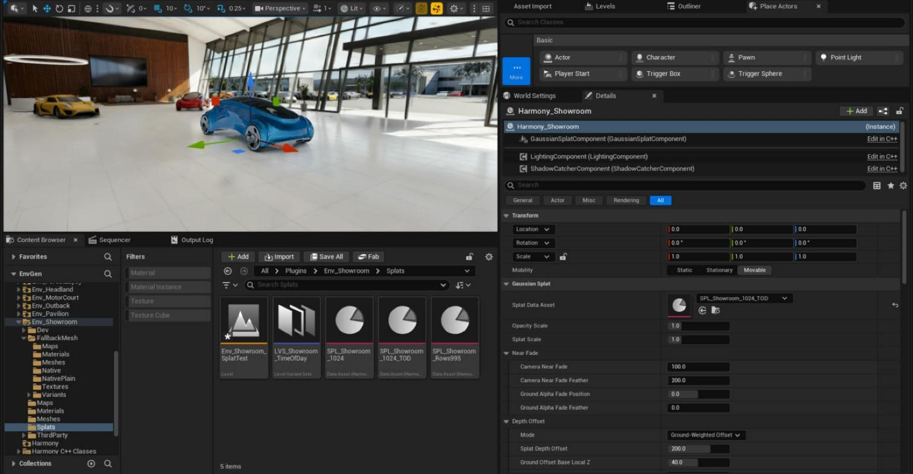
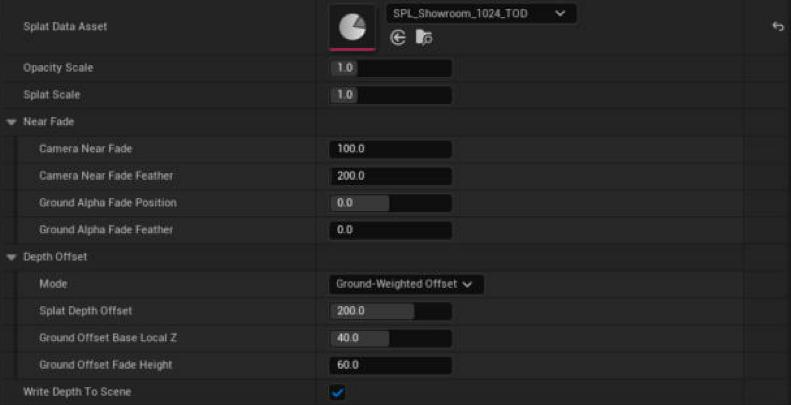

# Placing Splats

A Harmony Data Asset does nothing until something in the level shows it. This page covers the **Harmony Actor**, the **Harmony** component you can add to any actor, the per-splat settings in the Details panel, and the **Harmony Volume Actor** for cutting holes in splats.

---

## Placing a splat

The quick way:

1. Find your Harmony Data Asset in the **Content Browser**.
2. Drag it into the viewport.

A **Harmony Actor** is created with the asset already assigned, and the splat appears.

The manual way:

1. Open **Place Actors** and search for "Harmony".
2. Drag **Harmony Actor** into the level.
3. In the **Details** panel, under **Gaussian Splat**, set **Splat Data Asset**.

Then position it. Splat captures are rarely centred at the origin or level with the ground, so the first job is usually to move, rotate and scale the actor with the normal transform tools until the splat's ground sits on your level's ground.

### Where splats render

- Editor viewports
- Play In Editor and packaged games (Windows and macOS)
- Scene Capture components
- Movie Render Queue renders, including the Path Tracer

Splats are not lit by Unreal lights and do not cast shadows on Unreal geometry. They are drawn as captured. For making Unreal objects sit convincingly inside a splat, see [Lighting and shadows](10_LightingAndShadows.md).

### Hiding a splat

Hiding the actor stops the splat drawing. This works with the eye icon in the Outliner, the actor's **Hidden in Game** flag, and `Set Actor Hidden In Game` from Blueprint.

### Selecting a splat

**Clicking a splat in the viewport does not select its actor.** Splats are left out of the editor's click-picking pass, so the click goes straight through to whatever mesh is behind. Select Harmony Actors in the **Outliner** instead. More in [Debugging](11_Debugging.md#why-clicking-a-splat-does-not-select-it).

---

## What a Harmony Actor contains

| Component | What it does |
|---|---|
| **GaussianSplatComponent** (a Harmony component) | Draws the splat. It is the actor's root. |
| **LightingComponent** (Harmony Lighting) | Lights the level from the asset's lighting probe, if it has one. See [Lighting and shadows](10_LightingAndShadows.md). |
| **ShadowCatcherComponent** (Harmony Shadow Catcher) | Draws shadows and floor reflections of chosen actors onto the splat. See [Lighting and shadows](10_LightingAndShadows.md). |

Assets imported from splat files have no lighting probe, so the lighting component stays idle for them. It comes into play for splats baked with the Harmony Capture Rig.

### Adding a splat to your own actor

You do not have to use Harmony Actor. Select any actor or open any Blueprint, click **Add**, and choose **Harmony**. Set **Splat Data Asset** on the new component. It behaves exactly like the one inside Harmony Actor and follows the component's transform.

**Harmony Lighting**, **Harmony Shadow Catcher** and **Harmony Variant Manager Sync** can be added the same way. Each one works with the Harmony component on the same actor.

---

## Harmony component settings

Select the actor and look under **Gaussian Splat** in the Details panel. These settings are per component, so two splats in the same level can use different values.

### Basics

| Setting | Default | What it does |
|---|---|---|
| **Splat Data Asset** | None | The asset to draw. |
| **Opacity Scale** | 1.0 | Multiplies every splat's opacity (0 to 4). Below 1 the splat becomes see-through; above 1 it becomes denser, which can fill thin, wispy areas. |
| **Splat Scale** | 1.0 | Multiplies every splat's size on screen (0 to 4). Slightly above 1 can close small gaps; below 1 gives a pointillist look. |
| **Write Depth To Scene** | On | Writes the splat's depth into Unreal's scene depth after translucency has been drawn. Depth of field and temporal upscaling (TSR) then treat splat pixels at their real distance. Turn it off if a depth-based effect should ignore this splat. |

### Near Fade

Splats close to the camera turn into large, blurry blobs. Near Fade makes them transparent before that happens.

| Setting | Default | What it does |
|---|---|---|
| **Camera Near Fade** | 100 | Distance from the camera, in cm, inside which splats are fully transparent. |
| **Camera Near Fade Feather** | 200 | Distance over which splats fade back to full opacity beyond **Camera Near Fade**. 0 is a hard cut. |
| **Ground Alpha Fade Position** | 0 | A world height (Z, in cm). Splats at or below this height are **not** faded by the camera near fade. Use it to keep the ground solid under a low camera. |
| **Ground Alpha Fade Feather** | 0 | Height above **Ground Alpha Fade Position** over which that protection fades out. |

With the defaults, splats within 1 m of the camera are invisible and are fully visible from 3 m. For a small tabletop capture you will want to lower both numbers.

### Depth Offset

Splats are soft. A splat that represents the ground does not stop exactly at the ground; it has a fuzzy thickness. When you stand an Unreal mesh on splat ground, the bottom of the mesh ends up inside that fuzz and looks sunk or smeared.

Depth Offset fixes this by pretending the splats are further from the camera when Harmony decides whether a splat or an Unreal surface is in front. The splats do not move on screen; only the comparison changes.

| Setting | Default | What it does |
|---|---|---|
| **Mode** | Ground-Weighted Offset | **Simple View-Space Offset** applies the same offset to every splat. **Ground-Weighted Offset** applies the full offset near the ground and fades it out with height, so walls and objects still occlude Unreal geometry correctly. |
| **Splat Depth Offset** | 200 | The offset in cm (slider -500 to 500). Positive pushes splats away, so Unreal geometry wins more often. Negative pulls them closer. In Ground-Weighted mode this is the maximum, applied at the ground. |
| **Ground Offset Base Local Z** | 40 | Ground-Weighted only. The height, in the component's local space, at and below which the full offset applies. Set it to roughly where the splat's ground is. |
| **Ground Offset Fade Height** | 60 | Ground-Weighted only. The height range above the base over which the offset fades to zero. |

How to tune it for a car on splat ground: leave the mode on Ground-Weighted, set **Ground Offset Base Local Z** to the ground height, and raise **Splat Depth Offset** until the tyres are clean. If splat objects that should hide part of the car (a kerb, a bollard) stop doing so, lower **Ground Offset Fade Height**.

If the asset has baked variants, a **Variants** section also appears. See [Variants](09_Variants.md).

---

## Harmony Volume Actor

A Harmony Volume removes splats inside a box or sphere, or pushes them back in depth. Typical uses:

- Cut out a captured object so you can put an Unreal mesh in its place.
- Clear floating artefacts ("floaters") from an area the camera moves through.
- Remove splats only when the camera gets close to them.

Place one from **Place Actors** (search "Harmony Volume Actor"), or add a **Harmony Volume** component to any actor. In the editor the volume draws as a blue wireframe, with a second orange wireframe showing the feather distance. Move, rotate and scale it like any actor.

| Setting | Default | What it does |
|---|---|---|
| **Evaluation Stage** | Fragment | **Fragment** tests every pixel of every splat, so the cut follows the volume's surface exactly. **Preprocess** tests each splat's centre once and removes whole splats before they are sorted and drawn. Preprocess is faster and reduces the work the GPU does, but the edge is ragged. |
| **Effect Mode** | Alpha Cull | Fragment stage only. **Alpha Cull** makes splats inside the volume transparent. **Depth Offset** keeps them but pushes them back in depth so Unreal geometry in the volume shows in front. |
| **Shape** | Box | **Box** or **Sphere**. |
| **Box Extents** | 100, 100, 100 | Half-size of the box along each axis, in cm. |
| **Sphere Radius** | 100 | Radius in cm. |
| **Boundary Mode** | Hard | Fragment stage only. **Hard** cuts at the surface. **Feather** fades the effect over **Feather Distance**. |
| **Feather Distance** | 50 | Width of the fade in cm when **Boundary Mode** is Feather. |
| **Rule Mode** | Always Cull | **Always Cull** applies everywhere in the volume. **Cull If Camera Distance Less Than** only removes splats that are closer to the camera than **Camera Distance Threshold**. |
| **Camera Distance Threshold** | 300 | Distance in cm for the rule above. |
| **Depth Offset Amount** | 100 | How far to push splats back, in cm (0 to 1000), when **Effect Mode** is Depth Offset. |

Settings that do not apply to the current combination are hidden.

Which stage to choose: use **Preprocess** for large clean-up volumes where the exact edge does not matter, because it saves GPU time. Use **Fragment** when the edge is visible, when you want a feathered edge, or when you need the Depth Offset effect.

---

## Good to know

- **Volumes are global.** A Harmony Volume affects every Harmony component in the level. You cannot limit a volume to one splat.
- **Toggling a volume's visibility is not free.** It makes Harmony upload the scene's splat data to the GPU again, which causes a brief hitch on large scenes. Avoid switching volumes on and off every frame.
- **One asset per component.** To show several splats, place several actors or add several components.
- **Scale 100 is assumed.** Harmony draws assets whose stored unit scale is 100 (metres converted to centimetres), which is what every importer writes.
- **No collision.** Splats have no physics or collision. Add simple collision meshes yourself where characters or vehicles need a floor.
- **Splats are not selectable by clicking**, as described above.

---

## Next steps

- [Rendering settings](04_RenderingSettings.md): project-wide quality, tonemapping and performance
- [Variants](09_Variants.md): switching baked looks at runtime
- [Lighting and shadows](10_LightingAndShadows.md): lighting Unreal objects to match the splat
