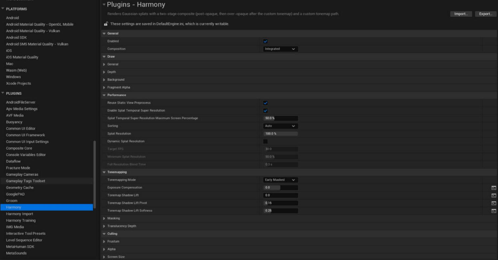
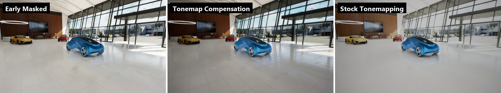

# Rendering Settings

Harmony's project-wide settings decide how splats are combined with Unreal content, how their colours survive tonemapping, and how much GPU time they cost. Two of them, **Composition** and **Tonemapping Mode**, matter far more than the rest. Read those two sections first; most projects never need to touch anything else.

---

## Where the settings are

**Edit > Project Settings > Plugins > Harmony**

- The settings apply to every splat in the project. Per-splat settings (opacity, near fade, depth offset) are on the Harmony component instead; see [Placing splats](03_PlacingSplats.md).
- Changes take effect immediately in open viewports. No restart is needed.
- They are saved to your project's `Config/DefaultEngine.ini`, so they are shared with your team and included in packaged builds.
- Import settings are a separate section, **Plugins > Harmony Import**, covered in [Importing splats](02_Importing.md).

### General

| Setting | Default | What it does |
|---|---|---|
| **Enabled** | On | Master switch. Off stops Harmony drawing anything. |
| **Composition** | Integrated | How splats and Unreal content are layered. See below. |

---

## Composition

Composition answers one question: **can a splat ever be drawn in front of Unreal geometry?**

A splat is a cloud of soft, semi-transparent blobs with real depth. To place a car inside a splat showroom properly, the splat floor must be behind the car while a splat pillar between the camera and the car must be in front of it. Doing that well takes several passes. If your project does not need it, a simpler mode is faster.

| Mode | What you get | Cost |
|---|---|---|
| **Integrated** | Splats are drawn both behind and in front of Unreal geometry and translucency, sorted by depth, with soft edges where they meet. | Highest |
| **Background Plate** | Splats are a backdrop. Unreal geometry and translucency are always drawn on top, wherever they are. | Lower |
| **Splats Only** | Harmony assumes the level contains nothing but splats. Every pixel is treated as splat. | Lowest |

### Integrated (default)

Harmony draws splats in two stages:

1. An **early stage**, after Unreal's opaque geometry and before translucency. This fills every pixel where no opaque Unreal surface is in front.
2. A **late stage**, after translucency. This adds the splats that are in front of Unreal geometry, and the splats in front of glass (see [Translucency in front of splats](#translucency-in-front-of-splats)).

The boundary between the two is feathered so a mesh standing in a splat does not get a hard cut-out edge.

Choose Integrated when Unreal objects sit *inside* a splat scene: a vehicle in a captured environment, a character walking behind captured foliage, product visualisation. It is the default and the mode all other features are designed around.

### Background Plate

Only the early stage runs. Any pixel covered by Unreal geometry or translucency shows the Unreal content, even if a splat is nearer the camera. The late stage, the mask edge feathering and the translucency split are all skipped.

Choose Background Plate when the splat is scenery that nothing needs to pass behind: a distant environment around a fully modelled foreground, or a backdrop outside a window. You will notice the difference from Integrated only where a splat object should hide part of an Unreal object, and it does not.

### Splats Only

On top of what Background Plate skips, Harmony also skips building the coverage mask and its own tonemap pass. Splat colours are never tonemapped in this mode, so [Tonemapping Mode](#tonemapping) has no effect on them.

Choose Splats Only for a pure splat viewer with no meshes in the level. Do not use it if any Unreal geometry is visible: the result will be wrong where the two overlap.

### Which one?

| Your project | Use |
|---|---|
| Unreal objects placed inside a splat scene | **Integrated** |
| Splats that must appear in front of glass or other translucency | **Integrated** |
| Splat as a backdrop behind an Unreal foreground, on modest hardware | **Background Plate** |
| A splat viewer with no other content | **Splats Only** |
| Unsure | **Integrated**, then try Background Plate if you need the frame time back |

Background Plate and Splats Only exist for low-power hardware. On a desktop GPU the default is usually fine. See also [Low-end hardware](../Guides/03_LowEndHardware.md).

---

## Tonemapping

### Why splats need special treatment

Unreal renders in linear HDR and then applies exposure and a film tone curve to produce the final image. A splat is different: its colours were learned from finished photographs or finished renders. They are **already** display-ready.

If Unreal's tonemapper is simply applied to splat pixels, the splat goes through a film curve twice. Highlights compress, contrast and saturation shift, and the splat no longer looks like the footage it was trained from. It also reacts to auto exposure, which it should not.

**Tonemapping Mode** chooses how Harmony avoids that.

| Mode | Splat colours | Unreal content | Cost |
|---|---|---|---|
| **Early Masked** (default) | Exactly as captured | Tonemapped by Harmony's own pass, built to match Unreal's | Extra passes for the mask and tonemap |
| **Tonemap Compensation** | Approximately as captured | Tonemapped by Unreal as normal | Very small |
| **Stock Tonemapping** | Tonemapped like any other pixel, so they change | Tonemapped by Unreal as normal | None |

### Early Masked (default)

Harmony builds a per-pixel mask of where Unreal content is, and runs its own tonemap pass on those pixels only. Unreal's own tonemapper then passes the image through unchanged. Splat pixels are never touched, so they keep exactly the colours they were captured with.

Harmony's pass follows the view's exposure, film curve, colour grading and bloom, and aims to match what the stock tonemapper would have produced for the Unreal pixels.

Choose it when the splat's look must be preserved exactly, which is nearly always the case for splats baked with the Harmony Capture Rig, where lit meshes are meant to match the splat. It is the most accurate mode and the most expensive. Its quality depends on the mask, which has its own [tuning settings](#masking-early-masked-only).

### Tonemap Compensation

Unreal's tonemapper runs over the whole frame as usual. Before that, Harmony brightens ("pre-expands") the splat colours with the inverse of the tone curve, so that after tonemapping they land roughly where they started.

It needs no mask and no replacement pass, so it is cheap and cannot produce mask edge artefacts. The price is accuracy: the inverse is an approximation. Very bright or very saturated splat colours can drift, and anything else in Unreal's post-process chain (colour grading, bloom) acts on the splats as well as on the meshes.

Choose it when Early Masked is too expensive for your target hardware, when you see mask artefacts you cannot tune out, or when you actually want your post-process grade applied to everything.

### Stock Tonemapping

Harmony does nothing. Splat colours are treated as if they were linear scene colours and go through exposure and the film curve like everything else. Splat pixels also count towards auto exposure, so a bright splat sky will darken the whole frame.

Choose it for comparison and debugging, or for stylised projects where a uniform grade over everything matters more than fidelity to the capture.

In **Early Masked** and **Tonemap Compensation**, Harmony also removes splat pixels from Unreal's auto exposure metering, so the brightness of the splat cannot push the exposure of your meshes up and down. This does not happen in Stock Tonemapping.

### Which one?

| Situation | Use |
|---|---|
| A splat baked with Harmony, with Unreal objects lit to match | **Early Masked** |
| An imported splat that must look like its source footage | **Early Masked** |
| Low-end hardware, or mask artefacts around glass, hair or particles | **Tonemap Compensation** |
| You want one colour grade over splats and meshes alike | **Tonemap Compensation** or **Stock Tonemapping** |
| Checking what the raw result looks like | **Stock Tonemapping** |

When **Composition** is **Splats Only**, splats are never tonemapped, whatever this is set to.

### Tonemapping settings

The **Tonemapping** category shows only the rows for the selected mode.

Early Masked:

| Setting | Default | What it does |
|---|---|---|
| **Exposure Compensation** | 0 | Extra exposure in stops (-8 to 8) applied to Unreal content in Harmony's tonemap pass. Leave at 0 to match the stock tonemapper. |
| **Tonemap Shadow Lift** | 0 | Lifts the darkest tones of Unreal content before tonemapping. Leave at 0 to match the stock tonemapper. |
| **Tonemap Shadow Lift Pivot** | 0.15 | Brightness at which the shadow lift starts to fade out. Only matters when the lift is above 0. |
| **Tonemap Shadow Lift Softness** | 0.25 | How gradual that fade is. Only matters when the lift is above 0. |

These offsets let you nudge the meshes towards the splat when their black levels do not quite agree. They do not change the splats.

Tonemap Compensation:

| Setting | Default | What it does |
|---|---|---|
| **Compensation Curve** | UE Film Curve | **UE Film Curve** inverts the film settings the view is actually using, with a highlight shoulder that stays safe with bloom. **Fixed ACES** uses a fixed approximation that does not change from scene to scene. |
| **Tonemap Compensation Scale** | 1.0 | Overall brightness of the splats after compensation (0 to 2). Lower it if splats look too bright. |
| **Tonemap Compensation Gamma** | 2.2 | Display gamma assumed when decoding splat colours. 2.2 is the reference value; change it only if you know your splat was authored differently. |
| **Tonemap Compensation Saturation** | 1.0 | Saturation trim after compensation (0 to 2). Lower it if splat colours come out too vivid. |

Stock Tonemapping has no settings.

---

## Masking (Early Masked only)

Early Masked depends on knowing, for each pixel, whether it shows Unreal content or splat. Opaque geometry is easy. Translucency, shadows drawn over splats, and antialiased edges are harder. The **Tonemapping > Masking** category tunes that decision. The defaults suit most scenes; come here when you see halos, flicker or wrongly coloured fringes where meshes meet splats. The **Harmony Scene Coverage Mask** view in [Debugging](11_Debugging.md) shows you the mask directly.

| Setting | Default | What it does |
|---|---|---|
| **Opaque Depth Distance** | 1000000000 | Furthest scene depth that counts as Unreal geometry. Keep it large. Lowering it leaves distant geometry un-tonemapped. |
| **Translucency Suppression Power** | 15 | How strongly translucent surfaces count as Unreal content. Higher means even faint translucency is treated as covering the splat. |
| **Direct Translucency Detection Threshold** | 0.001 | How big a colour change over a splat pixel must be before Harmony decides something was drawn on top of it. Lower detects subtler glass. |
| **Modulation-Only Residual Threshold** | 0.03 | Tells pure darkening (a shadow or modulation decal over the splat) from tinted glass. Darkening-only pixels keep their splat colour un-tonemapped. Lower is more cautious. |
| **Feather Mask Edges** | On | Softens the mask edge. |
| **Feather Radius (px)** | 1 | Width of that softening in pixels. |
| **Mask Expansion (px)** | 0 | Grows (positive) or shrinks (negative) the tonemapped region, -2 to 2 pixels. Use a small positive value for a dark or bright fringe around meshes. |
| **Use Mask History** | On | Stabilises mask edges over time to reduce flicker. |
| **Mask History Weight** | 0.9 | How much of the previous frame is kept at edge pixels. |
| **Mask History Velocity Falloff** | 2 | How quickly history is dropped as pixels move. Lower values trust history less during motion. 0 disables the falloff. |

---

## Translucency in front of splats

Category: **Tonemapping > Translucency Depth**. Applies in every tonemapping mode (in **Integrated** composition).

Translucent materials do not write depth, so Harmony cannot normally tell whether a splat is in front of or behind a pane of glass. By default all splats are treated as behind it. To get splats correctly in front of a translucent surface, such as captured foliage in front of a car windscreen, that surface must write Custom Depth:

1. In the translucent **material**, enable **Allow Custom Depth Writes**.
2. On the **mesh component**, enable **Render CustomDepth Pass**.

Harmony then draws splats nearer than that surface in the late stage, on top of the glass.

| Setting | Default | What it does |
|---|---|---|
| **Split Splats At Translucent Custom Depth** | On | Enables the behaviour above. |
| **Custom Stencil Value** | 0 | 0 accepts any mesh that writes Custom Depth. 1 to 255 restricts the split to meshes with that Custom Depth Stencil value. Use a reserved value if your project uses Custom Depth for other things, such as outlines. |
| **Custom Stencil Mask** | 255 | Bit mask for the stencil comparison. Shown when **Custom Stencil Value** is not 0. |
| **Depth Split Bias** | 5 | How far in front of the surface, in cm, a splat must be before it moves to the late stage. Raise it if splats flicker on the glass surface. |

---

## Performance

| Setting | Default | What it does |
|---|---|---|
| **Reuse Static View Preprocess** | On | When the camera and the splats have not changed, Harmony reuses the previous frame's sorted, rasterised splat layer instead of redoing it. A still camera then costs very little. Turn it off only to measure the uncached cost. |
| **Enable Splat Temporal Super Resolution** | On | Lets Unreal's TAA/TSR jitter apply to splats so the upscaler can recover sub-pixel detail from them. While active the splat layer is re-rasterised every frame. |
| **Splat Temporal Super Resolution Maximum Screen Percentage** | 50% | The jitter is only used when the screen percentage is at or below this. Above it, splats use a stable unjittered layer that can be fully cached. 100 uses it at every screen percentage. |
| **Sorting** | Auto | Where splats are depth-sorted each frame. **GPU** uses a compute shader. **CPU** sorts on a worker thread, freeing GPU time. **Auto** uses the CPU while the frame is limited by the GPU and the GPU otherwise, and avoids flipping back and forth. |
| **Splat Resolution** | 100% | Resolution of the splat layer per axis, relative to the render resolution. Splats are drawn at this size and scaled up, while Unreal content stays sharp. 70% roughly halves the splat fill cost. Particularly effective when depth of field blurs the splats anyway. |
| **Dynamic Splat Resolution** | Off | Lowers the splat resolution automatically while the camera moves, to hold **Target FPS**, and returns to full resolution when it stops. |
| **Target FPS** | 30 | Frame rate Dynamic Splat Resolution tries to hold. It only lowers resolution when the GPU frame time is over budget. |
| **Minimum Splat Resolution** | 50% | The lowest resolution Dynamic Splat Resolution may use. |
| **Full Resolution Blend Time** | 0.3 s | When the camera stops, ramp back to full resolution over this time instead of popping. Each frame of the ramp redraws the splats. 0 switches at once. |

Where to start when splats are too slow:

1. Lower **Splat Resolution** to 70 to 80%. This is the biggest single saving and often hard to see.
2. Turn on **Dynamic Splat Resolution** if the scene is mostly viewed from a still or slow camera.
3. Reduce the number of splats: see [Compression and decimation](05_CompressionAndDecimation.md).
4. Use the culling settings below, and the overdraw views in [Debugging](11_Debugging.md), to find where the cost is.
5. Reconsider **Composition** and **Tonemapping Mode**.

---

## Culling

Culling removes whole splats before they are sorted and drawn. Fewer splats means less sorting and less overdraw.

### Culling > Alpha

| Setting | Default | What it does |
|---|---|---|
| **Splat Min Alpha** | 0.06 | Splats whose opacity is below this are skipped. Raising it removes faint haze and floaters and speeds things up, but thin details start to vanish. |
| **Use Distance-Based Splat Min Alpha** | Off | Use a different threshold near and far, so distant splats can be culled harder than near ones. |
| **Near Splat Min Alpha** / **Far Splat Min Alpha** | 0.06 / 0.2 | Thresholds at the near and far distances. |
| **Near Alpha Distance** / **Far Alpha Distance** | 500 / 800 | The distances in cm between which the threshold blends. |

### Culling > Screen Size

| Setting | Default | What it does |
|---|---|---|
| **Min Screen Radius (px)** | 0 | Skips splats smaller than this many pixels on screen. 0.5 to 1 trims distant detail cheaply. |

### Culling > Frustum

| Setting | Default | What it does |
|---|---|---|
| **Base Frustum Padding** | 1.2 | How far outside the screen edge a splat's centre may be and still be drawn. Lower culls harder but can make large splats pop at the screen edge. |
| **Use Distance-Based Frustum Padding** | Off | Use different padding near and far. |
| **Near Padding** / **Far Padding** | 1.4 / 1.2 | Padding at the near and far distances. |
| **Near Distance** / **Far Distance** | 500 / 5000 | The distances in cm between which the padding blends. |
| **Near Cull Distance** | 0.2 | Splats closer to the camera plane than this are skipped. |

---

## Draw

| Category | Setting | Default | What it does |
|---|---|---|---|
| Draw > General | **Splat Pixel Radius** | 1.0 | Scales every splat's size on screen (0 to 2), for all splats in the project. For one splat, use **Splat Scale** on its component. |
| Draw > Depth | **Depth Write Coverage Threshold** | 0.1 | How solid the splats at a pixel must be before depth is written there (for components with **Write Depth To Scene** on). Raise it if depth of field or TSR reacts to faint splat haze. |
| Draw > Background | **Treat Early Background Splats as Opaque** | Off | Treats any pixel the early splat stage touched as fully covered. Meant for enclosing captures viewed from inside, where thin spots would otherwise let the level behind show through. |
| Draw > Fragment Alpha | **Splat Tail Cutoff** | 1.8 | How far each splat's soft edge extends (0.1 to 6). Higher is softer and fuller but draws more pixels. Lower is faster and crisper, and can open gaps. |
| Draw > Fragment Alpha | **Fragment Min Alpha** | 0 | Pixels of a splat fainter than this are not drawn. A small value such as 0.02 cuts overdraw from splat edges; too high makes splats look thin and harsh. |
| Draw > Fragment Alpha | **Clamp Instead Of Discard** | Off | Instead of dropping pixels below the cutoff, draw them at the cutoff value. |
| Draw > Fragment Alpha | **Use Distance-Based Fragment Alpha Cutoff** | Off | Use different cutoffs near and far: **Near Min Alpha** / **Far Min Alpha** (0 / 0.03) between **Near Distance** / **Far Distance** (500 / 800 cm). |

---

## Good to know

- **Everything here is global.** There are no per-level or per-actor overrides for composition, tonemapping or performance in this release.
- **Console variables.** Most rows have an `r.Harmony.*` console variable behind them, useful for trying values at runtime. Changing a variable in the console does not save it. The handful worth knowing are in [Debugging](11_Debugging.md). Those variables can also be overridden per platform with a device profile; [Low-end hardware](../Guides/03_LowEndHardware.md#limitations) lists which rows that covers.
- **Early Masked replaces part of Unreal's post-processing for Unreal pixels.** It is built to match the stock tonemapper, but if a mesh looks different with Harmony enabled, switch to Stock Tonemapping to compare.
- **Tonemap Compensation is approximate by design.** Do not expect it to match Early Masked exactly.
- **Settings may change.** The plugin is Alpha; names and defaults may move between releases.

---

## Next steps

- [Debugging](11_Debugging.md): see the mask, overdraw and stage coverage
- [Compression and decimation](05_CompressionAndDecimation.md): fewer, smaller splats
- [Low-end hardware](../Guides/03_LowEndHardware.md): a recipe for modest GPUs
