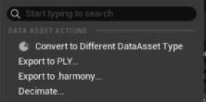

# Compression and Decimation

Two tools make a splat asset cheaper. **Compression** stores the same splats in fewer bytes. **Decimation** reduces the number of splats. Both are lossy, both leave your original asset untouched, and they can be combined.

| | Compression | Decimation |
|---|---|---|
| Reduces | Disk size and memory per splat | The number of splats |
| Speeds up rendering | Slightly | Yes: fewer splats to sort and draw |
| Visible change | Usually none | Depends on how far you go |
| On import | **Import Compressed** (on by default) | **Decimation Target Ratio** (off by default) |
| Later | Right-click > **Convert to Compressed** | Right-click > **Decimate...** |
| Keeps baked variants | Yes | **No** |

---

## Expanded and Compressed

Every Harmony Data Asset stores its splats in one of two encodings. You can see which in the Content Browser tooltip, or in the asset's **Encoding** field.

**Expanded** keeps full 32-bit floating point values for every splat: position, colour, shape and view-dependent colour (spherical harmonics). It is the highest precision and the largest.

**Compressed** quantises those values and reorders the splats so that neighbours in space sit together in memory. It is several times smaller on disk and is the recommended encoding for normal use, in the editor and in shipped games.

| Use | Encoding |
|---|---|
| Everyday rendering and shipping | **Compressed** |
| Splats with baked variants that should fade between looks | **Compressed** (required for animated transitions; see [Variants](09_Variants.md)) |
| A high-precision master copy inside the project | Expanded |
| BB Splat (textured billboard) assets | Expanded (the only option; see [BB Splat](07_BBSplat.md)) |

### How compressed assets are made

- **On import.** With **Edit > Project Settings > Plugins > Harmony Import > Import Compressed** on (the default), Gaussian `.ply`, `.splat`, `.spz`, `.ksplat` and `.sog` files are compressed as the last step of the import.
- **From `.npz`.** These files arrive already quantised and always import as Compressed.
- **From an existing asset.** Right-click an Expanded asset in the Content Browser and choose **Convert to Compressed**. A new asset named `<Name>_Compressed` is created next to the original and saved. The original is not changed.
- **From a bake.** Splats trained with the Harmony Capture Rig are written Compressed by default.

There is one built-in compression recipe. There are no quality presets to choose from.

### What can be compressed

- 3D Gaussian assets in the Expanded encoding, with spherical harmonics of degree 0 to 3.
- Not BB Splat assets. **Convert to Compressed** is not offered for them.

Baked variant sets are carried over to the compressed copy.

### What compression changes

| Data | Expanded | Compressed |
|---|---|---|
| Position | 32-bit floats | 16-bit offsets inside small spatial buckets |
| Opacity and overall size | 32-bit floats | Packed into one small word per splat, or a shared table when few values are used |
| Shape (covariance) | Two 4-float vectors | Three packed 32-bit words, half-float precision |
| View-dependent colour (SH) | 32-bit floats | 8 bits per value |
| Order of splats | As in the source file | Reordered by position (Morton order) |

Only the spherical harmonic coefficients the asset's SH degree needs are stored, so a degree 0 asset is much smaller than a degree 3 one:

| SH degree | Coefficients per splat |
|---|---:|
| 0 | 1 |
| 1 | 4 |
| 2 | 9 |
| 3 | 16 |

### Disk size is not GPU memory

Some of the disk savings are undone when the asset is loaded. Positions are decoded back to floats and shared tables are expanded before upload to the GPU. Shape and spherical harmonics stay quantised on the GPU. So a compressed asset uses less video memory than an Expanded one, but not by the same factor as on disk.

---

## Decimation

Decimation merges splats that are close together and look alike until a target count is reached. The result is a new asset with fewer splats. It renders faster and is smaller, at the cost of fine detail.

### Decimate an existing asset

1. Right-click a Harmony Data Asset in the Content Browser and choose **Decimate...**.
2. In the **Decimate Harmony Asset** dialog, enter the **Target percentage of splats to keep** (1 to 99, default 50).
3. Click **OK**.

A new asset named `<Name>_Decimated<NN>` is created next to the original, where `<NN>` is the percentage, for example `Showroom_Decimated50`. It is saved automatically. The original is not changed.

If the source asset is Compressed, Harmony expands it, decimates it and compresses the result again, so you get the same encoding back.

The new asset records where it came from: its **Source Asset Path** and **Decimation Target Ratio** fields are filled in. See the [Asset reference](06_AssetReference.md).

### Decimate on import

Set **Edit > Project Settings > Plugins > Harmony Import > Decimation Target Ratio** below 1.0 before importing. 0.5 keeps about half the splats. Decimation runs before compression, so the imported asset ends up at the reduced count whatever **Import Compressed** is set to.

Remember to set it back to 1.0 afterwards, or every later import will be decimated too.

### How far can you go?

It depends on the scene. A sensible way to find out:

1. Make copies at 75, 50 and 25 percent.
2. Place them side by side, or swap the **Splat Data Asset** on one actor.
3. Look at the things that break first: thin structures (railings, cables, foliage), text and sharp reflections.

Smooth surfaces such as walls, floors and sky survive heavy decimation. Fine detail does not. Decimating a copy for distant or low-end use while keeping the full asset for hero shots is a reasonable approach.

### What cannot be decimated

- BB Splat assets.
- `.npz` imports that use sparse indexing.

---

## Limitations

- **Decimation deletes baked variants.** Variant options are stored as changes to specific splats. Decimation replaces the splats, so the options no longer fit and are dropped from the new asset. If you need variants on a smaller asset, lower the splat count when baking instead. See [Baking variants](../Baking/05_Variants.md).
- **Both operations are lossy.** Keep the source file, or an Expanded asset, as your master.
- **There is no way back to Expanded.** A Compressed asset cannot be converted to Expanded in the editor. Re-import the source file with **Import Compressed** off.
- **Some source formats are already lossy.** `.spz`, `.sog`, `.ksplat` and `.splat` files store quantised data. Importing them as Expanded does not restore precision they never had.
- **Splat order changes.** Compressed assets are reordered, and decimated assets are rebuilt. Do not rely on splat index matching the source file.
- **Decimation takes time.** On assets with millions of splats it can run for a while, and the editor is busy until it finishes.

---

## Next steps

- [Importing splats](02_Importing.md): import settings
- [Asset reference](06_AssetReference.md): where the encoding and counts are shown
- [Rendering settings](04_RenderingSettings.md#performance): other ways to reduce cost
