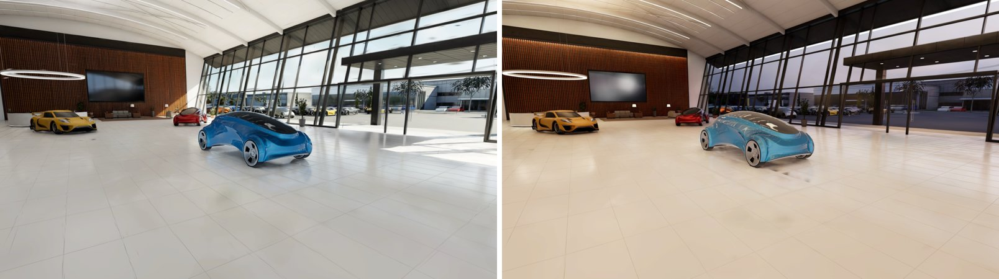
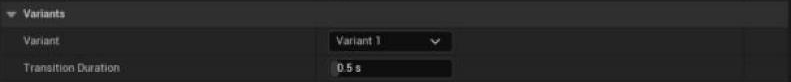

# Variants

A Harmony Data Asset can hold several looks of the same scene: day and dusk, a red or a blue feature wall, furniture in or out. These are **variants**. They are baked into the asset, and at runtime you switch between them, with an optional fade. This page covers switching. For creating variants, see [Baking variants](../Baking/05_Variants.md).

Variants come from Harmony's own baking. Splats imported from `.ply` and other files have none, and nothing on this page appears for them.

---

## How variants are organised

- An asset has one or more **variant sets**. A set is one independent choice, such as "Time of Day" or "Wall Colour". The Details dropdowns and the index functions cover the first four sets, with up to 32 options each.
- Each set has two or more **options**. One of them is the **base option**: the look of the base splats, with nothing applied.
- You choose one option per set. Sets combine, so two sets of three options give nine looks.

An option is stored as a list of differences from the base: changed colours, opacity, positions and shapes for some splats, plus any splats that only exist in that option. Switching option therefore changes only the splats that differ, which keeps switching fast and the asset small.

If two sets both change the same splat, the set that comes later in the asset wins. Sets work best when they affect different parts of the scene.

You can see an asset's sets, option names and sizes by opening the asset and looking under **Gaussian Splat > Variants > Variant Sets**. See the [Asset reference](06_AssetReference.md#gaussian-splat--variants).

---

## Switching in the Details panel

Select the Harmony Actor. If its asset has variants, a **Variants** section appears on the Harmony component.

| Setting | Default | What it does |
|---|---|---|
| **Variant** | Variant 1 | The option shown for the first variant set. |
| **Variant Set 2**, **Variant Set 3**, **Variant Set 4** | Variant 1 | The option shown for the second, third and fourth sets. Each appears only if the asset has that set. |
| **Transition Duration** | 0.5 s | How long a switch takes. The splats fade from the current look to the new one. 0 switches at once. Slider range 0 to 5 s. |

Things to know about the dropdowns:

- The entries are labelled **Variant 1**, **Variant 2** and so on. **They do not show your option names.**
- **Variant 1** is always the set's base option. **Variant 2** is the set's first other option, **Variant 3** the next, in the order they are listed in the asset.
- A set with only one option gets no dropdown.
- The choice is saved with the level, so the level opens showing the look you left it in.

To match the numbers to names, open the asset's **Variant Sets** list, or use the Blueprint functions below, which work with names.

**Transition Duration** applies to every way of switching: the dropdowns, Blueprint and the Variant Manager.

---

## Switching from Blueprint

The Harmony component has these functions, in the **Gaussian Splat > Variants** category. Get the component from a Harmony Actor with its **Gaussian Splat Component** property.

| Function | What it does |
|---|---|
| **Set Variant** (Set Name, Option Name) | Shows that option of that set, using **Transition Duration**. Pass the base option's name, or None, to return the set to the base look. Returns false if the asset has no such set or option. |
| **Set Variant With Duration** (Set Name, Option Name, Duration Seconds) | The same, with its own fade time for this one switch. 0 switches at once. |
| **Clear Variants** | Returns every set to its base option. |
| **Get Variant Set Names** | The names of the asset's variant sets. |
| **Get Variant Option Names** (Set Name) | The option names of one set, base option first. |
| **Is Variant Transition Active** | True while a fade is running or about to start. |

A typical setup is a UI button that calls **Set Variant** with the set name "Time of Day" and the option name "Dusk". Names must match the asset exactly.

**Set Variant** stores the request even when it returns false. If you assign a matching asset to the component later, the stored choice takes effect.

### Switching by index

If you would rather work with numbers, the component's **Variant Selection** object mirrors the dropdowns:

| Function | What it does |
|---|---|
| **Get Num Variant Sets** | How many sets have a dropdown (up to 4). |
| **Get Num Variants** (Set Index) | Options in that set, base included. 0 if there is no such set. |
| **Get Selected Variant** (Set Index) | The current option, counting from 0. 0 is the base. |
| **Select Variant** (Set Index, Variant Index) | Shows that option. Both indices count from 0. Returns false if either is out of range. |

Note that these indices start at 0, while the Details dropdowns start at "Variant 1". Index 0 is **Variant 1**.

The object's **Transition Duration** can also be read and set from Blueprint.

---

## Animated transitions

During a transition Harmony blends the changed splats from the old look to the new one: colour, opacity, position and shape all move together. Several switches can overlap. If you start a second switch while the first is still fading, the result blends smoothly from wherever it had got to.

The Harmony Actor's lighting follows along. If the two options have different lighting probes, the lighting on your Unreal objects crosses over during the fade, and the exposure eases to the new look's value. See [Lighting and shadows](10_LightingAndShadows.md#lighting-and-variants).

### Requirements and limits

- **The asset must be Compressed.** Expanded assets still switch variants, but always instantly; **Transition Duration** is ignored. Baked assets are Compressed by default. See [Compression and decimation](05_CompressionAndDecimation.md).
- **Up to three looks in flight per component.** If you fire off switches faster than they can finish and no slot is free, the newest request waits for the current fade to end. A newer request replaces one that is still waiting.
- **Transitions use extra video memory** while they run and for about ten seconds afterwards. All transitions in the level share a budget of 256 MB. If a transition does not fit, that switch happens instantly instead.
- **The first fade after loading may start a moment late**, because the option's data is prepared in the background and uploaded over a few frames.

---

## Driving variants from the Variant Manager

If your project already uses Unreal's **Variant Manager** (Level Variant Sets) to switch materials or visibility on meshes, the **Harmony Variant Manager Sync** component keeps the splat in step with it. Switch a variant in the Variant Manager and the splat switches too. This is the natural setup when the same Level Variant Sets were used to bake the splat's variants.

### Setup

1. Select the Harmony Actor (or whichever actor has the Harmony component).
2. Click **Add** and choose **Harmony Variant Manager Sync**.
3. On the new component, set **Level Variant Sets Actor** to the Level Variant Sets actor in the level.
4. Leave **Harmony Component** empty to drive the actor's first Harmony component, or pick a specific one.

| Setting | What it does |
|---|---|
| **Level Variant Sets Actor** | The Variant Manager data to follow. |
| **Harmony Component** | The splat to drive. Empty means the owner's first Harmony component. |
| **Sync Now** (button) | Reads the Variant Manager's current state and applies it immediately. |
| **Auto Activate** | The on/off switch. Untick it to stop syncing so you can choose variants by hand; tick it again and the Variant Manager's state is applied once. |

### How matching works

Matching is **by display name**. A Variant Manager variant set called "Paint" drives the Harmony variant set called "Paint". Within it, the active variant "Red" selects the Harmony option "Red". Sets or variants with no namesake on the other side are ignored.

It works in the editor (switching variants in the Variant Manager window updates the viewport) and at runtime (variants switched from Blueprint or a runtime UI). No Function Caller is needed in the Variant Manager.

The sync reacts as soon as a variant's captured properties are applied, and also checks about four times a second to catch changes it was not told about.

---

## Good to know

- **Dropdowns show numbers, not names.** This is a known rough edge.
- **Four sets, 32 options each** is the limit for the dropdowns and the index functions.
- **Variants do not survive changes to the splats.** Re-importing, retraining or decimating the asset drops its variant options. Compression keeps them.
- **Fades need Compressed assets**, as above.
- **Variant Manager variants with no captured properties** (Function Callers only) cannot be followed by the sync, because nothing tells it they were switched on.
- **`.harmony` export** carries the variant sets and the active selection, but not **Transition Duration**. See [.harmony files](08_HarmonyFile.md).
- **Baking variants is experimental.** See [Baking variants](../Baking/05_Variants.md).

---

## Next steps

- [Baking variants](../Baking/05_Variants.md): creating variant sets
- [Lighting and shadows](10_LightingAndShadows.md): lighting that follows the active variant
- [Asset reference](06_AssetReference.md): where variant data is listed
