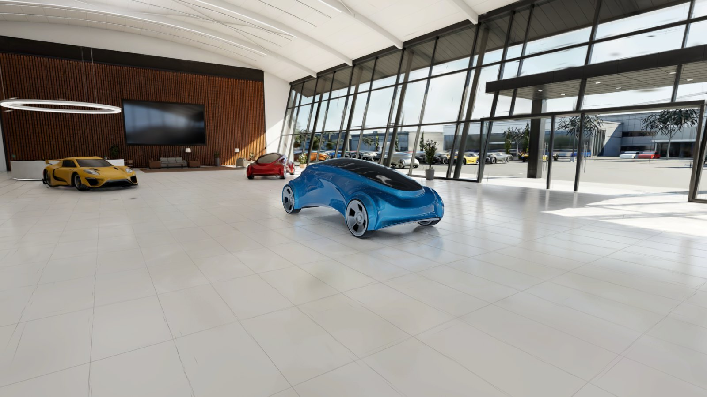
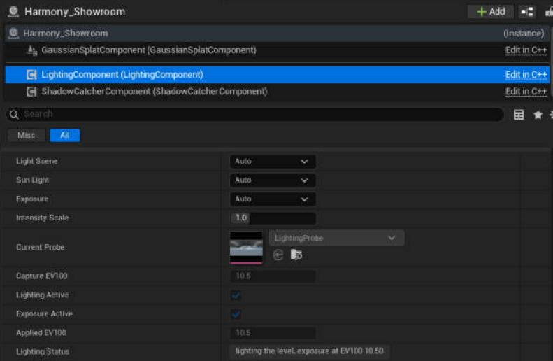
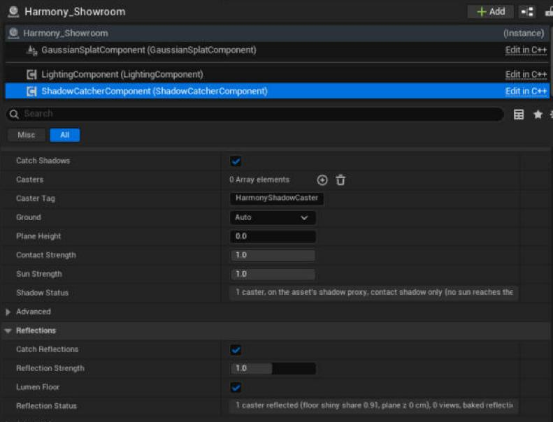

# Lighting and Shadows

A splat is a picture of a scene, not geometry with materials. Unreal's lights cannot brighten or darken it, and it does not light the meshes you put inside it. Left alone, a car placed in a splat showroom looks pasted on: lit by the wrong sky, casting no shadow, missing from the polished floor.

Two components on every Harmony Actor close that gap:

- **Harmony Lighting** lights your Unreal objects with the light that was in the captured scene.
- **Harmony Shadow Catcher** draws the shadows and floor reflections of your objects onto the splat.

---

## What you need

Most of this page relies on data that the Harmony Capture Rig records while it bakes a scene:

| Data in the asset | Recorded by the rig | Used for |
|---|---|---|
| **Lighting Probe** | A 360 degree HDR image from the rig's centre, the sun, and the capture's exposure | Lighting the level; sun shadows; dimming baked reflections |
| **Shadow Proxy** | A height map of the ground around the rig | Shadows that follow uneven ground |
| **Reflection Proxy** | How shiny the floor is, and the floor plane | Floor reflections |

See [Lighting capture](../Baking/06_LightingCapture.md) for how these are captured and which rig settings control them. You can check what an asset has by opening it and looking at its **Lighting** category ([Asset reference](06_AssetReference.md#lighting)).

**Splats imported from files have none of this.** For them the lighting component does nothing, there are no reflections, and the Shadow Catcher can still draw a soft contact shadow on a flat plane.

The rig's centre is where you are expected to put things. These pages call that spot the **stand**. The measurements (sun share, floor colour, reflection plane) are most accurate there.

---

## Harmony Lighting

The lighting component creates lights at runtime from the asset's lighting probe:

- a **sky light** using the probe image, so objects are lit and reflect the captured surroundings;
- optionally a **directional light** for the captured sun, since a sky light cannot stand in for a sun;
- optionally an unbound **post-process exposure** set to the capture's exposure, so lit objects come out as bright on screen as the splat around them.

These lights are temporary. Harmony creates them on the Harmony Actor while it is in the level, and they are not saved with it. Select the Harmony Actor and its **LightingComponent** to see the settings.

### Settings

Each of the first three settings has the same three choices: **Auto**, **Always**, **Off**.

| Setting | Default | What it does |
|---|---|---|
| **Light Scene** | Auto | Whether the probe lights the level through a sky light. **Auto**: yes, unless the level already has its own sky light. **Always**: yes, and Harmony's sky light takes over from the level's. **Off**: never. |
| **Sun Light** | Auto | Whether a directional light is made from the probe's sun. **Auto**: yes, unless the level has its own directional light, or the capture found the stand to be out of the sun (indoors or in shade). |
| **Exposure** | Auto | Whether the level's exposure is set to the capture's. **Auto**: yes while the probe lights the level, unless the level has its own enabled unbound post-process volume that overrides exposure. |
| **Intensity Scale** | 1.0 | Multiplies the probe's light (0 to 4). 1 is the captured scene's own brightness. |

Why **Auto** defers to the level: Unreal uses one sky light per world. If your level has one, Harmony assumes you want to stay in charge. Delete or disable your sky light, or set **Light Scene** to **Always**, to let the probe light the scene.

Why exposure matters: the splat was rendered at one fixed exposure and stays that bright whatever the camera does. Your meshes respond to exposure. If auto exposure drifts, the meshes get brighter or darker while the splat does not, and the match is lost. Pinning the exposure to the capture's value keeps them together.

### Status fields

The component reports what it is doing. Read these first when the lighting looks wrong.

| Field | Meaning |
|---|---|
| **Current Probe** | The probe in use: the asset's own, or the active variant option's. Empty if there is none. |
| **Capture EV100** | The exposure the capture was rendered at. |
| **Lighting Active** | Whether the probe is lighting the level right now. |
| **Exposure Active** / **Applied EV100** | Whether Harmony is setting the level's exposure, and to what. |
| **Lighting Status** | A sentence saying what is happening, or why nothing is. |

Common **Lighting Status** messages:

| Message | What to do |
|---|---|
| `lighting the level, exposure at EV100 ...` | Working. |
| `no Harmony asset` | Assign a **Splat Data Asset** on the Harmony component. |
| `the asset has no lighting probe` | The asset was imported from a file, or baked without a probe. Light the level yourself. |
| `Light Scene is Off` | Set **Light Scene** to Auto or Always. |
| `the level has its own sky light (set Light Scene to Always to take over)` | Remove your sky light or set **Light Scene** to **Always**. |
| `the actor is hidden` | Unhide the Harmony Actor. |
| `blending (N %)` | A variant fade is in progress. |

### Lighting and variants

A variant option can carry its own lighting probe, for example a dusk option with dusk lighting. When you switch variants, the lighting changes with the splats:

- The sky light blends from the old probe to the new one in step with the splat fade.
- With **Lumen** global illumination the probe is swapped at the middle of the fade instead, and Lumen's own gradual update softens the change.
- The sun light blends between the two suns.
- The exposure eases to the new look's exposure over a few seconds.

An option without its own probe keeps using the asset's.

---

## Harmony Shadow Catcher

No Unreal light can darken a splat, so Harmony draws the shadow itself. You tell it which actors cast shadows (the **casters**), and it darkens the splat ground under and beside them. It draws two kinds of shadow:

- A **contact shadow**: the soft darkening where an object blocks the sky from the ground beneath it. Sharp where a tyre touches the floor, soft under the body.
- A **sun shadow**: the directional shadow, when the capture recorded that the sun reaches the stand.

The mix between the two comes from the capture, which measured how much of the ground's light is direct sun.

### Choosing casters

Either:

- add the actors to the **Casters** list on the Harmony Actor's **ShadowCatcherComponent**, or
- give the actors the actor tag `HarmonyShadowCaster` (in the actor's Details, under **Actor > Tags**).

Tagging is easier for actors that are spawned or swapped. In the editor, tagged actors are picked up automatically when you edit tags, add or delete actors, or load a level. In a running game the level is searched once at Begin Play and again when a level streams in. **If you spawn or tag a caster at runtime, call Refresh Casters afterwards.**

Until at least one caster exists, the Shadow Catcher does no work and costs nothing.

### Shadow settings

| Setting | Default | What it does |
|---|---|---|
| **Catch Shadows** | On | Master switch for shadows. |
| **Casters** | Empty | Actors whose shadows are drawn. Set per actor instance in the level. |
| **Caster Tag** | HarmonyShadowCaster | Every actor in the level with this tag is also a caster. |
| **Ground** | Auto | What the shadows fall on. **Auto** uses the asset's shadow proxy (the captured ground shape) if it has one, otherwise a flat plane. **Plane** always uses a flat plane. |
| **Plane Height** | 0 | Height of that plane in cm, in the Harmony Actor's local space. Set it to the splat's floor level when a plane is used. |
| **Contact Strength** | 1.0 | Strength of the contact shadow (0 to 1). 0 turns it off. |
| **Sun Strength** | 1.0 | Strength of the sun shadow (0 to 1). 0 turns it off. Needs a lighting probe that says the sun reaches the stand. |
| **Shadow Status** | (read-only) | What is being drawn, or why nothing is. |

Advanced:

| Setting | Default | What it does |
|---|---|---|
| **Contact Spread** | 1.5 | How far the contact shadow spreads relative to the height of what casts it (0.1 to 4). 1 is a 45 degree cone. |
| **Sun Angle** | 1.0 | Angular size of the sun in degrees (0.1 to 10). Larger gives softer sun shadow edges away from the caster. |
| **Caster Map Resolution** | 512 | Resolution of the two depth captures of the casters (64 to 2048). Raise it if shadow edges look blocky. |

A working **Shadow Status** reads like `1 caster, on the asset's shadow proxy, contact and sun shadow`. If it ends with `contact shadow only (no sun reaches the stand, or the asset's probe stores none)`, there is no sun shadow because the capture found none to cast. Other messages: `Catch Shadows is off`, `no Harmony asset`, and `no casters (add actors to Casters, or give them the Caster Tag)`.

---

## Floor reflections

On a shiny floor, a real object is mirrored in it. If the asset has a reflection proxy, the Shadow Catcher also draws the casters' reflection into the splat floor. It is as strong and as sharp as the captured floor material allows: crisp on polished concrete, blurred on satin, absent on rough surfaces. Where a caster's reflection covers the floor, the reflection that was baked into the splat (the ceiling lights, say) is dimmed, as it would be in reality.

Reflections use the same casters as shadows.

| Setting | Default | What it does |
|---|---|---|
| **Catch Reflections** | On | Master switch for reflections. Needs an asset with a reflection proxy. |
| **Reflection Strength** | 1.0 | Strength of the reflection (0 to 2). 1 is what the floor's material reflects. |
| **Lumen Floor** | On | Adds a hidden floor under the casters that only Lumen sees. See below. |
| **Reflection Status** | (read-only) | What is being drawn, or why nothing is. |

Advanced:

| Setting | Default | What it does |
|---|---|---|
| **Reflection Resolution Scale** | 0.5 | Resolution of the mirrored render of the casters, relative to the view (0.25 to 1). Higher is sharper and costs more. |
| **Lumen Floor Margin** | 50 | How far, in cm, the hidden floor extends beyond the casters' footprint. A negative value uses the whole area of the reflection proxy. |
| **Lumen Floor Color** | Mid grey (0.6) | The hidden floor's colour, used only when the capture did not measure the real floor's colour (older captures). |

To switch reflections off everywhere in the project, set the console variable `r.Harmony.Reflections 0`.

### Lumen Floor

The lighting probe sees the floor as it was captured: bright and empty. Without help, Lumen lights the underside of your car with that bright floor, although in reality the car would be shadowing the floor beneath it. **Lumen Floor** places an invisible floor under the casters, in the captured floor colour, that Lumen uses for occlusion and bounce light. Nothing draws it. The underside and lower body of the car then get the darker, shadowed bounce they should.

The margin is deliberately small. Only the floor right under and beside the object is really darkened by it; a large hidden floor makes the object's sides too dark.

---

## Blueprint

| Component | Function | What it does |
|---|---|---|
| Harmony Lighting | **Set Light Scene** | Changes **Light Scene** at runtime. |
| Harmony Lighting | **Update Lighting** | Re-evaluates the lighting now. It normally runs by itself every frame. |
| Harmony Shadow Catcher | **Set Catch Shadows** / **Set Catch Reflections** | Turns shadows or reflections on and off. |
| Harmony Shadow Catcher | **Refresh Casters** | Searches the level again for actors with the **Caster Tag**. Call it after spawning or tagging a caster at runtime. The **Casters** list needs no refresh. |
| Harmony Shadow Catcher | **Update Shadows** | Re-evaluates the shadow captures now. It normally runs by itself every frame. |

The settings in the tables above can also be read and written from Blueprint.

---

## A typical setup

1. Bake the environment with the Harmony Capture Rig, with the rig's centre where the product will stand. See [Bake an Unreal scene](../Guides/02_BakeAnUnrealScene.md).
2. In the level that shows the splat, place the Harmony Actor. Remove the level's own sky light and directional light, or expect **Auto** to defer to them.
3. Place your object at the stand.
4. Tag the object `HarmonyShadowCaster`.
5. Check **Lighting Status**, **Shadow Status** and **Reflection Status** on the Harmony Actor's components.
6. Leave **Tonemapping Mode** on **Early Masked** so the splat keeps its captured colours while the object is tonemapped normally. See [Rendering settings](04_RenderingSettings.md#tonemapping).

---

## Limitations

- **Baked assets only, for the most part.** Lighting, sun shadows, ground-following shadows and reflections all need data from the Harmony Capture Rig.
- **One probe, one place.** The lighting is measured at the rig's centre. Objects far from the stand are lit as if they were at it, so the match gets worse with distance.
- **Shadows fall on the ground only.** They are drawn on the shadow proxy's height map or on a plane. Casters do not shadow splat walls or other splat objects. Objects in the splat do not cast shadows onto your meshes.
- **Reflections are on the floor plane only.** Splat walls, windows and car paint in the splat do not reflect your objects.
- **Only casters count.** Actors not in **Casters** and not tagged cast no shadow or reflection on the splat.
- **One sky light per world.** In **Auto**, a level sky light switches Harmony's lighting off. Two Harmony Actors with probes in one level cannot both light it. Harmony does not choose between them: each creates its own sky light, and its own sun if the probe has one. Unreal uses only the most recently enabled sky light, so which probe wins depends on the order the actors started lighting, while every sun they create lights the level. Set **Light Scene** and **Sun Light** to **Off** on all but one.
- **Any composition or tonemapping mode.** Shadows and reflections are drawn into the splats as they render, in every **Composition** and **Tonemapping Mode**, and adapt to whether the splats are tonemapped.
- **Cost.** With casters present, Harmony renders two small depth captures of them, and with reflections, a mirrored render of them for each view.

---

## Next steps

- [Lighting capture](../Baking/06_LightingCapture.md): recording the probe, shadow proxy and reflection proxy
- [Variants](09_Variants.md): switching looks, with lighting that follows
- [Debugging](11_Debugging.md): console variables and views for diagnosing problems
