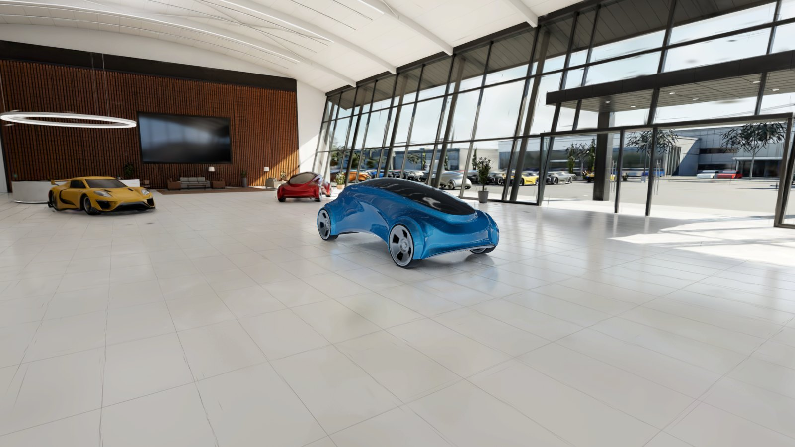
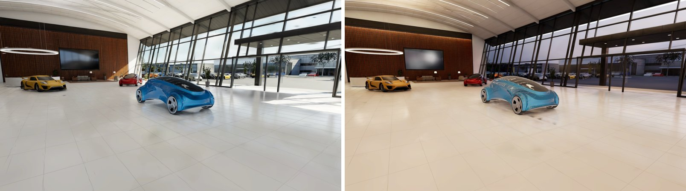

# Harmony

Gaussian splat rendering and scene baking for Unreal Engine. Import splats from common tools and render them alongside regular Unreal content, or bake an Unreal scene into a splat without leaving the editor.



> **Alpha.** Harmony is in active development. APIs, asset formats and settings may change between releases, so expect to update your project when you update the plugin.

**[Live demo](https://spacemonster.s3.us-east-1.amazonaws.com/harmony/demo/index.html)** · **[Video overview](https://youtu.be/ZiBRiuQxpFk)** · **[Documentation](Docs/README.md)** · **[Releases](https://github.com/restlesspixels/Harmony/releases)**

---

## What Harmony does

### 1. Renders Gaussian splats in Unreal

Harmony draws splats in the editor and in packaged games, mixed with your meshes, lights and effects.

- **Imports the common formats.** `.ply`, `.spz`, `.sog`, `.splat`, `.ksplat` and `.npz`, plus textured billboard (BB) splats. Assets are compressed on import by default, and can be decimated to a fraction of their splat count at import or later.
- **Keeps the captured look.** Composition and tonemapping modes control how splats combine with Unreal content. By default Unreal content goes through the tonemapper and the splats keep the colours they were captured with.
- **Integrates with depth and translucency.** Meshes sit inside the splat with correct occlusion. Splats can draw behind and in front of translucent surfaces, and they write scene depth for depth of field and temporal upscaling.
- **Has performance controls.** Lower or dynamic splat resolution, temporal super resolution, CPU or GPU sorting, alpha, frustum and screen-size culling, and culling volumes.
- **Switches variants with animated transitions.** One asset can hold several looks, such as time of day or material options. Switch them from the Details panel, Blueprint or Unreal's Variant Manager.
- **Lights and grounds your meshes.** A lighting probe stored in the asset lights the level to match the splat. A shadow catcher draws mesh shadows onto the splats, and glossy floors can reflect your meshes.



### 2. Bakes Unreal scenes into splats

Harmony captures an Unreal level and trains it into a Gaussian splat inside the editor. There are no external tools to install and no CUDA requirement.

- **Capture rig.** Place a **Harmony Capture Rig**, size a box over the area viewers will stand in, and choose a camera pattern (grid, radial or jittered rows). Scrub through every shot before you render.
- **In-editor GPU training with live preview.** One button renders the views, builds the dataset and trains the splat. Training runs in the background and you watch the splat sharpen in the viewport.
- **Variants.** Bake material swaps or Variant Manager variants (for example a time of day) into the same asset as switchable options. This feature is experimental.
- **Lighting capture.** The bake records a lighting probe, a shadow proxy and floor reflection data, so meshes you add later are lit, shadowed and reflected to match.
- **Dataset export in COLMAP format.** Every capture is cached on disk as images, depth and COLMAP poses, ready to retrain or to use with an external trainer.
- **Fallback meshes.** Build simplified, textured meshes of the same scene from the capture, in several triangle budgets.

---

## Requirements

| | |
|---|---|
| **Unreal Engine** | 5.9.0 exactly for this release. The binaries are tied to the engine build. |
| **Splat rendering** | Windows (D3D12) and macOS (Apple Silicon and Intel), in the editor and in packaged games |
| **Scene baking and fallback mesh builder** | Editor only, on Windows with an SM6-capable GPU (D3D12 or Vulkan). Tested on an RTX 3090-class GPU. |
| **Project type** | Blueprint-only and C++ projects |

Harmony ships as precompiled binaries. The macOS binaries are signed and notarised.

---

## Install

There is no compile step. Close the editor first, then use either method.

**From a release zip**

1. Download the zip for your engine version from [Releases](https://github.com/restlesspixels/Harmony/releases), for example `Harmony-0.0.1-UE5.9.zip`.
2. Extract it into `<YourProject>/Plugins/`. The zip contains a `Harmony` folder, so the plugin ends up at `<YourProject>/Plugins/Harmony/`.
3. Open your project.

**From git**

Run this in your project folder:

```
git clone -b ue5.9 https://github.com/restlesspixels/Harmony.git Plugins/Harmony
```

The plugin is enabled by default. It also enables Unreal's Movie Render Queue and Variant Manager Content plugins, which it depends on. See [Installation](Docs/Rendering/01_Installation.md) for details.

---

## Quick start: render a splat in 5 minutes

1. Install the plugin as above and open your project.
2. Drag a Gaussian splat file (for example a `.ply`) into the **Content Browser**. Harmony imports it as a Harmony Data Asset and saves it.
3. Drag the new asset into the level viewport. This creates a **Harmony Actor** that shows the splat.
4. Move and rotate the actor until the splat sits where you want it. Splats are rarely centred on their origin.
5. Press **Play**.

PLY files must be binary little-endian with spherical harmonics degree 3, which is what most 3D Gaussian splatting tools write by default. The full walkthrough is in [Render your first splat](Docs/Guides/01_RenderYourFirstSplat.md).

---

## Documentation

The full index is in [Docs/README.md](Docs/README.md).

| Start here | |
|---|---|
| [Render your first splat](Docs/Guides/01_RenderYourFirstSplat.md) | Install, import a `.ply`, place it and play |
| [Bake an Unreal scene](Docs/Guides/02_BakeAnUnrealScene.md) | Capture and train an interior, start to finish |
| [Running on low-end hardware](Docs/Guides/03_LowEndHardware.md) | The settings that make splats cheaper to draw |

| Rendering | |
|---|---|
| [Importing](Docs/Rendering/02_Importing.md) | Supported formats and their constraints |
| [Placing splats](Docs/Rendering/03_PlacingSplats.md) | Harmony Actor, Harmony component, Harmony Volume |
| [Rendering settings](Docs/Rendering/04_RenderingSettings.md) | Composition, tonemapping, performance and culling |
| [Variants](Docs/Rendering/09_Variants.md) | Switching looks at runtime, with transitions |
| [Lighting and shadows](Docs/Rendering/10_LightingAndShadows.md) | Lighting probe, shadow catcher, reflections |

| Baking | |
|---|---|
| [Overview](Docs/Baking/01_Overview.md) | What baking is, what it needs and what it costs |
| [Capture rig](Docs/Baking/02_CaptureRig.md) | View area, camera patterns, exclusions, exposure |
| [Capture and train](Docs/Baking/03_CaptureAndTrain.md) | The buttons, progress and training options |
| [Dataset cache](Docs/Baking/04_DatasetCache.md) | The COLMAP dataset and external trainers |
| [Fallback mesh](Docs/Baking/07_FallbackMesh.md) | Building simplified meshes from a capture |

---

## Supported formats

| Extension | Format |
|---|---|
| `.ply` | Gaussian splat PLY (binary little-endian, SH degree 3), or BB splat PLY with its companion texture archives |
| `.spz` | Niantic SPZ |
| `.sog` | PlayCanvas SOG |
| `.splat` | Packed binary splat |
| `.ksplat` | GaussianSplats3D KSPLAT |
| `.npz` | NumPy archive (quantised web-splat layout) |
| `.harmony` | Harmony's own engine-version-independent asset file |

See [Importing](Docs/Rendering/02_Importing.md) for the details of each format.

---

## Showcase

| | |
|---|---|
| **Live demo (Windows and macOS)** | [Download the demo](https://spacemonster.s3.us-east-1.amazonaws.com/harmony/demo/index.html) |
| **Video overview** | [Watch on YouTube](https://youtu.be/ZiBRiuQxpFk) |

The demo includes Gaussian splat assets that are not part of this repository.

---

## Versions and releases

- There is one branch per engine version, for example `ue5.9`. `main` follows the newest supported engine.
- Each release is a tagged [GitHub Release](https://github.com/restlesspixels/Harmony/releases) with a zip named for the plugin and engine version, such as `Harmony-0.0.1-UE5.9.zip`.
- The current release is **0.0.1 for Unreal Engine 5.9.0**. Binaries only load in the exact engine version they were built for.

Harmony is made by Spacemonster Interactive. It is closed source and distributed as precompiled binaries.
